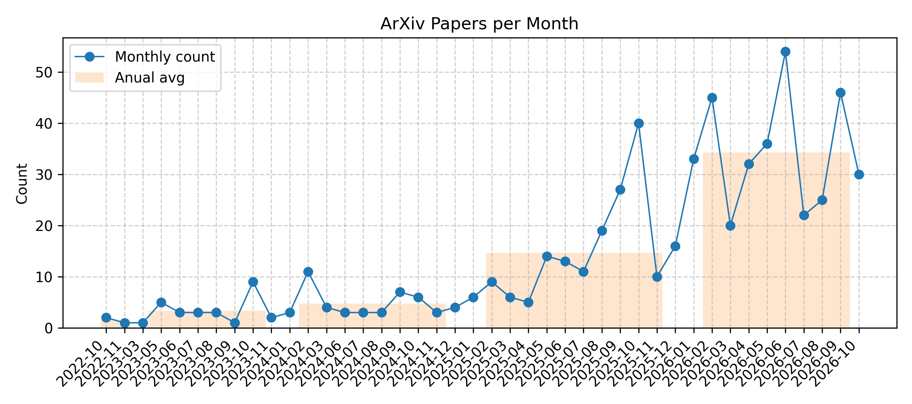

[![Contributors][contributors-shield]][contributors-url]
[![Forks][forks-shield]][forks-url]
[![Stargazers][stars-shield]][stars-url]
[![Issues][issues-shield]][issues-url]

For more carefully curated articles, you can refer to this [repository](https://github.com/bansky-cl/Diffusion_NLP_Papers).

## Updated on 2026.10.26

## diffusion

|Date|Title|label|Abstract|PDF|Code|
|---|---|---|---|---|---|
|**2026-10-22**|**Diffusion Language Models for Perplexity-Aware Black-Box Attacks**|cs.LG, cs.CL, stat.ML| 

Full Abstract
\emph{Continuous-space} attacks find prompts that trigger malicious behaviors, such as overthinking, in black-box LLMs by sampling or optimizing over a low-dimensional Gaussian latent space and decoding it to text through a \emph{random mapping} and nearest-token lookup. Because the random mapping is not learned from language, its prompts can be highly unnatural, and as such easily detectable through input guardrails, and the risk estimates they yield are not grounded in natural prompts. In this paper, we demonstrate that the same continuous latent-space framework can be coupled directly to a learned generative distribution over language, a continuous diffusion language model (dLLM), which removes the artificial random mapping while preserving the standard-Gaussian latent formulation and the downstream sampling or optimization procedure. We evaluate this approach under two settings: sampling-based estimation using \emph{RareTrap} and optimization-based search using \emph{ThinkTrap}. We find that character-level perplexity drops from $10^3$--$10^7$ to 3--5 in RareTrap and from 20--28 to 4.3--5.4 in ThinkTrap. We also find that model risk estimates can differ by an order of magnitude across the two mappings.
|[2610.31558v1](http://arxiv.org/abs/2610.31558v1)| null|
|**2026-10-21**|**Looped Uniform Diffusion Language Models**|cs.CL, cs.LG| 

Full Abstract
Uniform diffusion language models (UDLMs) generate text by iteratively denoising sequences of ordinary vocabulary tokens, any of which may be corrupted and subsequently revised. During training, UDLMs must denoise from a context that may itself be unreliable, whereas masked diffusion language models (MDLMs) always condition on a clean context. This challenging training objective makes UDLMs more FLOP-intensive to train than MDLMs, but it yields stronger downstream reasoning performance. Recently, selective looping, which recursively applies a few early Transformer layers within each denoising step, has been shown to improve training efficiency in MDLMs under an iso-FLOP budget. We investigate looping in UDLMs while keeping the training objective and sampler unchanged. We find that looping significantly improves training efficiency: looped UDLMs reach the validation NLL of a non-looped UDLM trained on about 0.5 trillion tokens with up to 2.8x fewer training FLOPs on OpenWebText and 3.3x fewer on FineWeb-Edu. We also find that, at a matched NFE budget, looped UDLMs reach up to 9.8% lower generation perplexity than the non-looped UDLM, with most gains achieved at moderate loop counts. Finally, we study different loop-count distributions and find that sampling smaller loop counts more frequently during training improves inference efficiency: on downstream tasks, this strategy uses 12% fewer loops than uniform loop-count sampling without degrading accuracy.
|[2610.30066v1](http://arxiv.org/abs/2610.30066v1)| null|
|**2026-10-21**|**A Diagnostic Study of Faithfulness in Diffusion Language Models for Table-to-Text Generation**|cs.CL, cs.LG| 

Full Abstract
Diffusion language models generate by iteratively denoising a masked sequence under bidirectional attention, without the strict left-to-right commitment of autoregressive decoding. Whether this difference affects how reliably they remain grounded in structured inputs is largely unexplored. We study this question in table-to-text generation using ToTTo, where highlighted source cells make factual grounding directly testable. We compare the masked diffusion models MDLM and LLaDA with GPT-2 and GPT-Neo under an identical retrieval-based few-shot protocol, together with a QLoRA-adapted LLaDA, and we score reference similarity and source grounding as separate axes. The two pull apart. Within LLaDA, additional demonstrations raise BLEU from 11.3 to 22.0 while NLI entailment against the source table falls from 0.78 to 0.52; QLoRA reaches the best BLEU of the study, 24.15, and grounds no better for it. Manual annotation shows the failure modes differ in kind: the autoregressive baselines tend to wander off the table, while LLaDA-based models more often stay on topic and swap out individual entities. Reference-based metrics alone are insufficient to assess faithfulness in table-to-text generation.
|[2610.29602v1](http://arxiv.org/abs/2610.29602v1)| null|
|**2026-10-21**|**Hierarchical Masked Diffusion Language Models**|cs.CL, cs.AI| 

Full Abstract
Masked diffusion language models have emerged as an alternative to autoregressive models, enabling parallel token generation. However, standard masked diffusion language models use a shared noise schedule across positions without explicitly encoding which positions should be resolved first. Many tasks exhibit a natural priority among positions: document titles and section headings can guide the generation of body text, while Sudoku cells determined directly from the initial clues can help resolve more difficult cells. To incorporate this notion of priority (or hierarchy) among token positions, we introduce the Hierarchical Masked Diffusion Language Model (HMDLM), which augments each token position with a hierarchy level available as part of the training data, and requires zero or minimal additional annotations. It factors generation into two passes: the first predicts a hierarchy distribution over masked positions, the second predicts token distributions conditioned on it. Giving each hierarchy level its own noise schedule induces a soft, controllable preference for revealing higher-priority positions earlier while keeping decoding fully parallel. Our formulation is mathematically grounded, and we re-derive the forward and reverse processes and the NELBO for this factorization. Our evaluation shows that for the task of language generation on LM1B, HMDLM reduces perplexity by more than 1.5 points over Anchored Diffusion Language Model (ADLM), a recently proposed strong diffusion baseline; on WikiHow, we see a drop in perplexity of up to 4.4 pts on ADLM and up to 7 pts against MDLM. An LLM judge on WikiHow prefers HMDLM generations (the two variants combined) more than $2\times$ as often as the baseline. On the task of solving Sudoku puzzles requiring multi-step reasoning, it improves solution accuracy by up to $8.6\%$ absolute points over existing diffusion baselines.
|[2610.29255v1](http://arxiv.org/abs/2610.29255v1)| null|
|**2026-10-21**|**GRAFT: Restoring the Missing Sampling Interface in Continuous Diffusion Language Models**|cs.CL, cs.AI| 

Full Abstract
Continuous diffusion language models generate a whole sequence in parallel, never drawing a single word at any intermediate step; only the final step turns embeddings into text. Models such as ELF now report autoregressive-level quality at a fraction of the sampling steps of discrete-token diffusion models, and this design principle -- no step-wise discretization -- is what their own ablations credit for the gain. We show that this same principle carries a hidden cost: a collapse of the lexical long tail. Measured against held-out human text, ELF's output matches the human rate on common words almost exactly, yet its rarest words appear at only 0.30x the human rate, a gap that does not close from 105M to 652M parameters and that no sampler setting these models expose can reach. A same-size GPT-2, in contrast, spans zero to above the human rate by its decoding rule alone. We trace the difference to what continuous diffusion models lack: with no step that ever draws a discrete word, every step is instead driven by an average over the candidates still in play, and averaging a rare candidate together with the common word competing for its slot lands on the common word. An autoregressive model avoids this because its decoding rule samples one candidate rather than averaging over all of them. We propose GRAFT, a training-free method that grafts this missing choice back onto a frozen model: while the model is still undecided, GRAFT commits the rare words the average would otherwise discard, then regenerates the sequence from scratch with those commitments held in place. Across three ELF scales and on LangFlow, an independent continuous dLLM, GRAFT restores the rare-word share of generated text from 0.42-0.77x the human rate to 0.82-1.10x, a relative gain of 34-109%, and moves the entire word-frequency profile closer to human on every model tested, by 2.7x on ELF-B and 12x on LangFlow.
|[2610.29136v1](http://arxiv.org/abs/2610.29136v1)| null|
|**2026-10-20**|**Binary Discrete Diffusion: Candidate-Set Diffusion for Logic and Planning Tasks**|cs.LG, cs.AI, cs.CL, stat.ML| 

Full Abstract
Discrete diffusion models iteratively denoise a noisy sequence of categorical data such as text, enabling any-order generation with self-correction and in-filling capabilities. This makes them promising candidates for reasoning, planning, and constrained-generation tasks like coding and math. Yet masked and uniform diffusion erase a token's identity in a single corruption event, so their noisy states cannot explicitly represent partially resolved uncertainty in which several alternatives remain plausible. We close this gap with Binary Discrete Diffusion, a family of continuous-time discrete-diffusion processes whose noisy state is a set of candidate tokens per position, represented as a binary membership vector. Binary diffusion changes candidate sets through additions and removals, allowing information to be lost and recovered gradually while the diffusion state itself represents partial uncertainty. On Sudoku-Extreme, Boxoban, and graph coloring, the symmetric formulation of binary diffusion consistently outperforms strong, well-tuned masked and uniform baselines under matched architectures and controlled training, sampling, and tuning budgets, with its largest gains on the hardest instances, while remaining competitive on language modeling (Text8, TinyStories, OpenWebText). These results support candidate sets as an effective intermediate representation for iterative reasoning and show that the corruption kernel can materially change the computation learned by the reverse model.
|[2610.28543v1](http://arxiv.org/abs/2610.28543v1)| null|
|**2026-10-20**|**Self-Decomposing Diffusion for Code Generation**|cs.CL| 

Full Abstract
Diffusion language models (DLMs) are emerging as a promising paradigm for code generation, offering the potential for fast, parallel decoding. However, generating complex programs remains challenging, as their interdependent components must maintain consistent interfaces, data flows, and shared assumptions. Aggressive parallel decoding can compromise these dependencies and undermine program correctness, while conservative decoding sacrifices efficiency. To address this trade-off, we propose planning program decomposition before implementation to coordinate interdependent units during parallel generation. We introduce Self-Decomposing Diffusion for Code (SDDC), a novel framework that decomposes complex programs and implements their units in parallel, entirely through diffusion. SDDC first generates a contract specifying the program's decomposition and inter-unit dependencies, then uses it to guide coordinated parallel implementation. Across five benchmarks and two 7B diffusion backbones, SDDC substantially improves the accuracy--latency trade-off, raising pass@1 by up to 31.1 percentage points while decoding 7.5--13.7$\times$ faster than the base models, and outperforming a fine-tuning baseline by up to 23.5 points with lower latency.
|[2610.27600v1](http://arxiv.org/abs/2610.27600v1)| null|
|**2026-10-21**|**Beyond Model Weights: Sampling-Dependent Fairness in Diffusion Language Models**|cs.CL| 

Full Abstract
Diffusion language models (DLMs) are emerging as a practical alternative to autoregressive language models (ARLMs), yet their fairness remains largely uncharacterized. DLMs introduce sampling controls with no direct autoregressive counterpart, such as block length and remasking strategy, that directly set their speed--quality operating point. This raises a basic question: does a DLM's measured social bias remain stable across these settings? Across LLaDA, LLaDA-1.5, and Dream on Open-BBQ, we find that all three models exhibit social bias, but both the magnitude of measured bias and the relative ordering of models by bias are highly sensitive to the sampling configuration. This sampling dependence also changes what successful debiasing means. While mitigation strategies established for ARLMs transfer effectively to DLMs and reduce bias without degrading downstream performance, sampling dependence persists even after mitigation. Our results show that fairness in DLMs cannot be characterized independently of the sampling configuration, even after debiasing. Project page is available at https://pakapaka333.github.io/Beyond-Model-Weights/.
|[2610.27584v2](http://arxiv.org/abs/2610.27584v2)| null|
|**2026-10-20**|**TeCoP: Accelerating Diffusion Large Language Model Decoding via Tentative Context Pipelining**|cs.CL| 

Full Abstract
Diffusion large language models (dLLMs) predict multiple token positions per forward pass, yet block-wise decoders serialize generation and repeatedly recompute stable predictions. We attribute this inefficiency to coupling a prediction's readiness for irreversible commitment with its utility as context. We introduce Tentative Context Pipelining (TeCoP), a training-free decoder that decouples these roles through staggered block-parallel pipelining and draft-and-verify. TeCoP reuses stable but uncommitted predictions as provisional cross-block context, with commitment governed by confidence and stability checks. Across four LLaDA and Dream dLLMs on GSM8K, Minerva MATH, and MBPP, TeCoP reduces number of forward evaluations by up to 87% and achieves up to 7.50-fold throughput without KV caching and 11.77-fold with caching over the uncached original decoder. It outperforms Fast-dLLM and DSB in throughput across all 12 model-benchmark settings, with and without caching, while keeping average cached accuracy within one percentage point of the original decoder.
|[2610.27583v1](http://arxiv.org/abs/2610.27583v1)| null|
|**2026-10-20**|**Factual Access States in Diffusion Language Models: From Mechanism to Knowledge Editing and Retrieval**|cs.CL, cs.AI, cs.IR, cs.LG| 

Full Abstract
Factual recall is a lookup: some representation inside the network serves as the key, and what that key is made of decides which queries can retrieve the fact, what an edit must cover, and what a retriever can read. We call it the factual access state. In autoregressive (AR) models the subject position enriches attributes largely independently of the relation, and relation-specific selection happens later, at the readout position. In masked diffusion language models (DLMs) we find the state is assembled differently, and much earlier: in the first attention layer the wording of the relation is routed into the position of whichever entity is visible and the early feed-forward layers look the fact up on this fused representation. The state therefore varies with the relation's surface form and with the query direction, so the queries about one fact occupy a region of state space rather than a point, and an operation on the fact succeeds only for queries that enter it. We treat the state as an interface to a DLM's factual knowledge, and put it to two uses. Writing to the state gives a knowledge editor: from one declarative statement, Multi-View Edit fits one shared value per direction across that region and installs it in the early-MLP block, preserving source-prompt reliability while substantially improving paraphrase and reverse question answering, where AR editors gain near zero. Reading it suggests a complementary use: the state at each entity position can serve as a relation-specific retrieval vector with no training, returning both pieces of evidence for two-entity queries on which pooled, prompted and lexical retrievers almost never return both.
|[2610.27580v1](http://arxiv.org/abs/2610.27580v1)| null|
|**2026-10-19**|**DStill: Trajectory Consistency Distillation for Accelerated One-Step Drafting in Block Diffusion Speculative Decoding**|cs.CL, cs.LG| 

Full Abstract
Block-diffusion speculative decoding accelerates large language model inference by drafting multiple tokens in parallel. However, one-step drafting in discrete diffusion is limited by token factorization error: each token is predicted from the same masked block, without conditioning on the tokens selected at other positions in that step. This can produce inconsistent drafts and reduce acceptance length. Iterative refinement mitigates this limitation by conditioning later predictions on previously committed tokens, though additional passes increase drafting cost. To address this trade-off between draft fidelity and inference latency, we introduce DStill, a two-stage framework that distills a target-conditioned drafter's own multi-step refinement into one-step drafting. We first train the drafter to complete partially revealed blocks, then use its refinement trajectories to train a student to predict the final completion in one pass. Using a curriculum that gradually transitions from partial to fully masked inputs, we successfully transfer the multi-step refinement capabilities into one step. Across reasoning, math, code benchmarks on three model families DStill improves acceptance length by up to 28% and speedup by up to 25% over one-step DFlash, achieving up to 6.45x speedup over auto-regressive decoding.
|[2610.27379v1](http://arxiv.org/abs/2610.27379v1)| null|
|**2026-10-19**|**Breaking Diffusion: Parallel Reasoning with Draft Refinement**|cs.AI, cs.CL, cs.LG| 

Full Abstract
Drafting an answer allows a reasoning model to reconsider each decision in the context of the others. Yet repeated diffusion denoising does not ensure that individually plausible token updates form a better answer together. We introduce Draft Refinement Language Models (DRLMs), which use a single denoiser to propose parallel revisions and evaluate a candidate draft. We train the denoiser to reconstruct every token from uniformly corrupted drafts, teaching both preservation and repair. Its predictions specify revisions directly, without a diffusion reverse transition. Evaluation requires a different use of these predictions: confidence in an existing token reflects both contextual support and evidence from observing the token itself. Using the known corruption process, we correct for this self-token evidence to estimate how well each token is supported by the prompt and the remaining draft. Aggregating these estimates yields a cavity energy computed in one forward pass, without an additional scoring model. Each round proposes a revision, reads the completed candidate in its revised context, and retains it only if its energy is lower. Across Countdown, Sudoku-Extreme, and Maze-Hard, our method outperforms autoregressive and discrete diffusion baselines. With 6M parameters, DRLM reaches 44.4% on Countdown-5 and 93.9% on Sudoku-Extreme. The results establish complete-draft parallel refinement as an effective alternative to reverse diffusion for complex reasoning.
|[2610.26542v1](http://arxiv.org/abs/2610.26542v1)| null|
|**2026-10-19**|**ReAnchor: Reusing Rejected Verifier States for Diffusion Drafting**|cs.CL| 

Full Abstract
Block diffusion drafters accelerate speculative decoding by generating multiple draft tokens in a single forward pass. However, each pass produces only a fixed-length block from a single target-generated anchor, limiting how far the draft can extend. Meanwhile, target verification computes hidden states even at positions beyond the first rejection, but these states are typically discarded rather than reused. We propose ReAnchor, a training-free method that reanchors a pretrained drafter at shifted positions using discarded verifier states to generate parallel draft blocks. These blocks improve predictions within the original block and extend coverage beyond its endpoint. At sampling temperature of T=0, ReAnchor achieves its largest average gains on Gemma 4-12B, improving acceptance length by 19.4% and decoding speed by 17.9% across eight benchmarks. Averaged equally over four target models and eight benchmarks, it improves acceptance length by 15.2% and decoding speed by 13.4% with pretrained DFlash drafters.
|[2610.26531v1](http://arxiv.org/abs/2610.26531v1)| null|
|**2026-10-19**|**Balance-Aware Pivot Selection for Parallel Diffusion LLM Decoding**|cs.CL| 

Full Abstract
Diffusion language models enable parallel token generation, offering a promising alternative to sequential autoregressive decoding. Existing acceleration methods use predictive confidence to enable parallel token commitment while preserving generation quality. However, confidence-based selection prioritizes reliable token predictions without explicitly considering how token positions shape the remaining decoding schedule. Moreover, such ordering does not always reflect inter-token dependencies, suggesting that confidence need not be the sole criterion for token selection. Motivated by this limitation, we propose Balance-Aware Pivot Decoding (BPD), which favors central pivots within contiguous masked intervals and decodes the selected positions in parallel. Balanced pivots yield logarithmic decoding depth in the interval length. Our practical method accounts for model uncertainty by combining confidence-based prefilling with confidence-thresholded center selection. We evaluate the resulting quality-efficiency tradeoff on LLaDA and Dream across five mathematical reasoning, code generation, and instruction-following benchmarks. Our implementation is available at: https://anonymous.4open.science/r/DLM_random_pivot-EE62/
|[2610.26040v1](http://arxiv.org/abs/2610.26040v1)| null|
|**2026-10-19**|**Keep the Lineages Alive: Diversity-Preserving SMC for Diffusion LLM Decoding**|cs.LG, cs.AI, cs.CL, stat.AP, stat.ML| 

Full Abstract
Inference-time sequential Monte Carlo (SMC) decoding can improve the reasoning accuracy of masked diffusion language models (diffusion LLMs) without post-training by resampling a population of partial generations according to a reward. Its effectiveness therefore depends on the resampling step, which must concentrate computation on promising candidates while retaining enough diversity to explore alternative reasoning paths. The reward can be internal, the decoder's own confidence on the committed prefix, or external, a process reward model scoring that prefix. Under either reward, multinomial resampling can disrupt this balance by duplicating high-weight particles and discarding lineages that may still reach a correct solution. The effective sample size (ESS) does not register this loss: multinomial resampling resets it to its maximum even as distinct lineages disappear. To retain such lineages, we introduce lineage-preserving SMC (LP-SMC), which combines Chopthin resampling with an input weight floor. Instead of equalizing weights, Chopthin bounds the ratio between the largest and smallest weights it returns and carries the unequal weights forward. The floor limits how far below the maximum a weight may fall before resampling so that lineages with low early weight keep a chance to recover. Across mathematical-reasoning and code-generation benchmarks on two base models, LP-SMC raises oracle coverage, the fraction of problems with at least one correct particle, in every setting, by 1.8 to 25.6 points, and raises end-to-end accuracy under a common reward-model selector in eleven of twelve settings, by up to 7.9 points on LLaDA-1.5 and 18.3 on Dream-7B. The coverage gain persists under the external reward model, which suggests that diversity-preserving resampling and the guidance signal contribute separately to inference-time search.
|[2610.25932v1](http://arxiv.org/abs/2610.25932v1)| null|
|**2026-10-19**|**Diffusion Language Models Change Speed Across Tasks and Languages**|cs.CL, cs.AI, cs.LG| 

Full Abstract
Diffusion language models can write several tokens in one forward pass, and they decide during generation how many passes to spend. Two outputs of the same token length can therefore vary a lot in cost. To understand the underlying factors of this cost variation, we analyze two diffusion models across 10 tasks. We find that the number of forward passes per token depends heavily on the task. Text copied or lightly edited from the input is cheap, while open-ended writing is costly. In DiffusionGemma, generating a token for story writing requires more than three times as many forward passes as for grammar correction. Two output properties explain much of this gap: how much of it is new relative to the input, and how rare its words are within the task. The same holds within a single response when thinking is involved. The final answer is cheap when it repeats the model's reasoning trace and costly when it adds something new. In multilingual generation, we find that highly tokenized languages also require more passes per token, adding to the cost they already pay with more tokens. Finally, cost tracks correctness: on the same math problem, wrong answers take more passes per token than correct ones, and weighting candidate answers by decoding speed beats majority voting by up to 4.2 points at no extra cost. Taken together, our results show that diffusion's computational advantage depends on how much of the output is already determined, while its decoding effort offers a practical signal for making inference more efficient and reliable.
|[2610.25835v1](http://arxiv.org/abs/2610.25835v1)| null|
|**2026-10-18**|**Enhanced Masked Diffusion Unlearning**|cs.LG, cs.AI, cs.CL| 

Full Abstract
Masked diffusion language models (MDLMs) generate text by iteratively unmasking tokens with bidirectional context. As these models reach real-world deployment, machine unlearning becomes essential. This process aims to remove the influence of a designated "forget set" without retraining from scratch, so that sensitive, copyrighted, or restricted content can no longer be elicited while preserving retained capabilities. Masked Diffusion Unlearning (MDU) is the first publicly available unlearning method customized for these models: it tunes the model $p_θ$ to match a frozen prompt-masked anchor $p_{\mathrm{anchor}}$ on the forget set by minimizing the anchor-last divergence $\mathrm{KL}(p_θ\Vert p_{\mathrm{anchor}})$. We identify two failure modes of MDU. First, random answer masking can leave key forget tokens visible to the anchor even when the question is fully masked. Second, at a memorized (near-one-hot) prediction, the anchor-last logit gradient vanishes while the anchor-first divergence $\mathrm{KL}(p_{\mathrm{anchor}} \Vert p_θ)$ logit gradient does not. As a result, MDU training stalls on the tokens we most need to forget. Backed by theoretical and empirical analyses, we propose Enhanced Masked Diffusion Unlearning (EMDU): anchor-first KL divergence toward a frozen anchor whose entire answer span is masked. On TOFU and RWKU benchmarks using LLaDA-8B and Dream-7B, our EMDU matches or exceeds the forgetting of MDU and adapted AR baselines, while better preserving retain utility.
|[2610.25447v1](http://arxiv.org/abs/2610.25447v1)| null|
|**2026-10-17**|**Who Gets Unmasked? Sampler-Induced Bias in Diffusion Language Models**|cs.CL, cs.LG| 

Full Abstract
Diffusion language models (dLLMs) generate by gradually unmasking a canvas, so their samplers decide not only which token to write but also when to commit it. We show that this second decision changes who appears in generated text, a sampler-induced bias on top of the model's own. Common commit rules, including LLaDA's default, commit the positions whose sampled tokens are most probable; this peeking favors majority options. To separate the sampler from the model, we read the model's belief about a fork, such as a protagonist's gender, in one forward pass, and show that this belief matches exact sampling from the model. Measured against it, peeking samplers on LLaDA and Dream amplify occupational gender stereotypes and collapse opinion distributions, and confidence-based ordering shifts gender-balanced occupations toward men, more so under faster parallel decoding. We propose Fork-First Sampling, which decides the fork before anything else is written: it follows the belief or any target distribution, improves fluency, and avoids the stories that remark on the protagonist's gender, which prompt-based fixes produce, at the cost of one forward pass. Fairness evaluations of dLLMs should report the commit rule.
|[2610.24795v1](http://arxiv.org/abs/2610.24795v1)| null|
|**2026-10-17**|**PV-Decoding: Progressive Verification Decoding with Decode Gating for Diffusion Language Models**|cs.CL| 

Full Abstract
Discrete diffusion language models (dLLMs) offer an attractive alternative to autoregressive generation by updating multiple tokens in parallel, but their inference efficiency is still limited by the cost of safely committing tentative predictions. In particular, speculative decoding for dLLMs is challenging because speculative tokens within the same diffusion block may depend on one another, making aggressive acceptance prone to error propagation and strict verification computationally expensive. We present PV-Decoding, a confidence-driven speculative decoding framework with progressive verification for block diffusion inference. PV-Decoding partitions masked positions into directly decoded tokens, speculative tokens, and unresolved tokens using two confidence thresholds, and then verifies speculative tokens with progressively stronger policies, including single-batch, dual-batch, and multi-batch verification. This design exposes a practical accuracy--efficiency trade-off: weaker verification minimizes overhead, whereas stronger verification improves acceptance precision and robustness. Experiments on three diffusion language models across GSM8K, MBPP, and HumanEval show that PV-Decoding reduces sequential model forward passes (MFPs) by 8%--37% relative to confidence-based decoding, while keeping the largest observed accuracy drop to 1.3%. On Dream-7B-Instruct/GSM8K, PV-Decoding (1-batch) and PV-Decoding (2-batch) improve throughput by 7.0%--13.6% under the same hardware budget, whereas PV-Decoding (multi-batch) is slower under the current runtime. These results suggest that confidence-guided speculation with structured verification is a practical path toward efficient and reliable dLLM inference.
|[2610.24722v1](http://arxiv.org/abs/2610.24722v1)| null|
|**2026-10-17**|**DiffuPlan: Editable Planning State for Diffusion Language Model Agents**|cs.CL, cs.AI| 

Full Abstract
Diffusion language models (dLLMs) are emerging as an alternative to autoregressive (AR) language models, yet dLLM agents largely inherit an interaction protocol designed for AR generation: once intermediate state is written, later observations can only be incorporated by appending more text. This is a poor match to a defining capability of dLLMs -- reconstructing earlier text conditioned on context that appears both before and after it. We ask whether this capability can support a different agent-state paradigm in which intermediate planning state is directly revisable as evidence arrives. We introduce DiffuPlan, a diffusion search agent that maintains a single editable planning state and reconstructs only the affected steps when later evidence resolves an entity or changes the search route. To support variable-length revisions, we introduce Expansion-Partition Marginalization (EPM), which marginalizes over equivalent expansion paths. We further adapt diffusion trajectory RL to multi-turn search. Across four multi-hop QA benchmarks, DiffuPlan achieves 50.24 average F1, outperforming strong AR search agents. More importantly, under identical data and training, editable planning state improves the diffusion agent by 2.44 F1 versus only 0.47 for its AR source model. These results show that dLLMs need not imitate append-only AR agents: revising committed state is a distinct agentic advantage.
|[2610.24717v1](http://arxiv.org/abs/2610.24717v1)| null|
|**2026-10-16**|**Preservation and loss of algorithmic structure in experimental diffusion of joint-action norms**|cs.CL, cs.MA| 

Full Abstract
Everyday norms of social interaction - e.g. norms of sharing space, taking turns, or queuing - are essential to large societies, offering structured procedures for common interactions. However, it remains unclear how the underlying algorithms of these implicit joint plans evolve as they diffuse through populations. Here we show that this process of diffusion can select against complex algorithms in the earliest stages. We conducted a large-scale study of experimental diffusion of novel social norms among human participants, leveraging advances in program synthesis to characterize the procedures people developed in independent populations. Inherited procedures became structurally simplified and lost during interactions between participants who inherited different variants of joint-action norms; however, opportunities for interactive repair offset this pressure, preserving complex algorithms despite misalignment. These results demonstrate that interactive reasoning mediates selective pressures on structural complexity during cultural evolution of procedural norms.
|[2610.24150v1](http://arxiv.org/abs/2610.24150v1)| null|
|**2026-10-16**|**LED: Improving Masked Diffusion Language Models by Lookahead Editing**|cs.LG, cs.CL| 

Full Abstract
Diffusion large language models (dLLMs) have emerged as a promising alternative to autoregressive language models, enabling non-autoregressive text generation through parallel decoding. Existing dLLMs can be broadly categorized into two families: masked diffusion models (MDMs) and uniform diffusion models (UDMs) In this work, we theoretically show that MDMs are easier to optimize due to their mask-based transition schedule but have lower computational expressivity, whereas UDMs enable iterative state revision and greater expressivity but are substantially harder to train. This trade-off raises a natural question: can we obtain the expressivity of iterative revision without giving up the simple, easy-to-optimize transition schedule of MDMs? Motivated by this analysis, we propose Lookahead Editing (\ours{}), which augments masked diffusion decoding with a rewritable proposal state. At each decoding step, the model performs several lookahead updates to iteratively refine future predictions in this proposal state before committing tokens to the masked sequence. This design introduces a rewritable proposal that uses additional compute to improve expressivity while keeping the simple mask-based transition schedule of MDMs. We fine-tune Qwen2.5-7B and Qwen3-8B to obtain LED-\texttt{7B} and LED-\texttt{8B}, respectively. Across eight benchmarks, LED SFT yields average gains of $+11.4$ and $+7.7$ points over standard MDM SFT. Moreover, using SFT alone, LED-\texttt{8B} outperforms LLaDA2.1-16B Q-mode, which is trained with continued pre-training, supervised fine-tuning, and reinforcement learning.
|[2610.23122v1](http://arxiv.org/abs/2610.23122v1)| null|
|**2026-10-15**|**Multi-Target Few-Shot Prompting with Diffusion Language Models**|cs.CL| 

Full Abstract
Few-shot prompting is useful when instructions and rewards are hard to specify. One such application is editing by example, where a demonstrated formatting change or API migration may need to be applied across multiple sites. However, such edits often depend on both left and right context, making generation with causal autoregressive models awkward. We therefore introduce multi-target few-shot prompting with diffusion language models, where examples guide the infilling of multiple masked regions within a shared canvas. To address the known challenge of reliably following demonstrations in few-shot prompting, we further leverage selective masking of the canvas to derive a likelihood-ratio reward that favors example-supported infills. Across few-shot prompting benchmarks and software refactoring case studies, we find that demonstrations improve infilling accuracy, with example guidance yielding further gains in several settings.
|[2610.22294v1](http://arxiv.org/abs/2610.22294v1)| null|
|**2026-10-15**|**Diffusion Language Models as Open Quantum Systems**|cs.LG, cs.CL, quant-ph| 

Full Abstract
Diffusion language models generate text by reversing a classical diffusion process over token sequences. We show that their continuous-time forward and reverse dynamics can be embedded in the framework of open quantum systems, which describes quantum systems interacting with their environment. This connection provides a basis for extending diffusion sampling to superpositions of sentence states and for modifying the underlying generation dynamics. We construct a $τ$-leaping unraveling scheme that simulates stochastic trajectories of these states while updating multiple token positions at each step. This enables generation conditioned on superposed prompts or thoughts, which we call Superposition of Prompts (SoP) and Superposition of Thoughts (SoT). The same formulation yields Quantum-Inspired Remasking (QIR): perturbing the masked-diffusion dynamics produces a confidence-based rule for revising previously generated tokens. Experiments with pretrained diffusion language models show that superposition-based generation can retain information from conditioning components not selected at the final measurement, while QIR improves LLM-assessed text quality when applied at an appropriate stage of generation.
|[2610.21672v1](http://arxiv.org/abs/2610.21672v1)| null|
|**2026-10-14**|**One Block Ahead: Promoting Sampler State in Diffusion Language Models**|cs.CL| 

Full Abstract
Block-diffusion language models denoise a whole block of token positions in parallel so each forward pass can emit many tokens. However, blocks are still denoised in strict sequence, a cost that within-block acceleration leaves untouched. Here, we investigate decoding blocks concurrently and propose One Block Ahead (OBA), a training-free decoding algorithm that denoises the next block alongside the current one. We demonstrate that for uniform-state diffusion LMs, where a block's denoising progress is not visible in its intermediate tokens, concurrent decoding is advantageous if the next block's tokens are promoted together with the corresponding sampler state, including the self-conditioning signal and the denoising time. We also derive a break-even criterion that relates the benefit of OBA to the relative cost of a paired-block forward pass. On DiffusionGemma, a state-of-the-art diffusion LM, OBA increases the tokens per forward pass by 42.3% (from 15.64 to 22.25) and the single-request denoising throughput by 16.3%, averaged over ten benchmarks, with a small accuracy regression.
|[2610.19510v1](http://arxiv.org/abs/2610.19510v1)| null|
|**2026-10-14**|**ForkGRPO: Efficient Exploration and Fine-Grained Credit Assignment for Diffusion Language Models**|cs.CL| 

Full Abstract
Diffusion large language models (dLLMs) have advanced rapidly, yet strengthening their reasoning through reinforcement learning (RL) remains an open challenge. Any-order generation can suffer from entropy degradation, which narrows the reasoning paths available for exploration. Recent work mitigates this issue by applying standard GRPO with left-to-right generation. However, independently generating every rollout from the input prompt can leave alternative continuations from intermediate states underexplored, while trajectory-level advantages assign uniform credit to all tokens without distinguishing the contributions of individual reasoning segments. We propose ForkGRPO, an RL framework that couples efficient exploration with fine-grained segment-level credit assignment. It samples multiple continuations from high-entropy intermediate states along a reference trajectory, prioritizing textual boundaries and reusing shared prefixes. The continuations provide complementary learning signals: within-state group-relative advantages guide which continuations to reinforce, while Monte Carlo state-value differences indicate which reasoning segments improve expected outcomes. Among the evaluated architecture-preserving RL methods, ForkGRPO achieves the best performance on three of four benchmarks, while improving over the directly comparable JustGRPO by up to 1.2 percentage points and using up to 27.8% fewer generated tokens. ForkGRPO-Fast further achieves a $2.49\times$ training wall-clock speedup with negligible accuracy loss.
|[2610.19408v1](http://arxiv.org/abs/2610.19408v1)| null|
|**2026-10-13**|**Multi-Stream Residual Computation in Diffusion Language Models**|cs.LG, cs.CL| 

Full Abstract
Diffusion language models reconstruct masked tokens in parallel, offering an alternative to autoregressive generation. Yet their Transformer backbones typically carry visible evidence and evolving masked predictions through a single residual stream. We equip masked diffusion models with multiple residual streams that persist through depth and adaptive routing between them, then investigate how they support these complementary roles. On the pretraining task, two streams reduce reconstruction perplexity by 5.71% on validation data and 5.13% on average across external corpora compared with standard residual connections. We observe that, without predefined roles, visible and masked positions learn distinct routing patterns. Causal interventions show that this distinction organizes read and write routing, while token-specific write strength remains important within each role. Guided by these findings, a model trained with role-conditioned routing recovers half the validation gain from adding a second stream. State interventions explain the benefit of the additional stream: it preserves early token representations for later reuse while evidence accumulates at masked positions. This mechanism recurs at a larger model scale, showing how persistent streams support context preservation alongside prediction refinement.
|[2610.18407v1](http://arxiv.org/abs/2610.18407v1)| null|
|**2026-10-13**|**TRACESTEER: Trace Driven Activation Steering for Hallucination Mitigation in Diffusion Language Models**|cs.CL| 

Full Abstract
Diffusion large language models (dLLMs) have emerged as a promising alternative to autoregressive LLMs, yet remain susceptible to hallucination. Activation steering offers a promising mitigation approach by guiding parallel token predictions through internal representations. However, existing steering methods largely overlook two characteristics of dLLMs: dynamic denoising states and temporal hallucination risks, which challenge predefined steering vectors and uniform intervention strengths. We propose TRACESTEER, a trace-driven activation steering framework that uses preceding denoising predictions as feedback to jointly adapt steering direction and strength. Specifically, Denoising Feedback Steering (DF-Steering) constructs step-specific steering vectors from preceding predictions and current hidden states. Trajectory-Guided Steering Gate (TS-Gate) regulates their strength using prediction uncertainty and the denoising timestep. With the backbone frozen, factual supervision and magnitude regularization jointly guide the learning of adaptive steering interventions, promoting factual reliability and stability throughout denoising. Experiments on two dLLMs show improved factual reliability on TruthfulQA and generalization across five downstream benchmarks.
|[2610.18173v1](http://arxiv.org/abs/2610.18173v1)| null|
|**2026-10-13**|**Match the Canvas, Not Just the Answer: Predictability-Aware SFT for Diffusion Language Models**|cs.LG, cs.AI, cs.CL| 

Full Abstract
Diffusion language models (DLMs) enable flexible parallel generation by resolving tokens according to the model's evolving predictability rather than a fixed left-to-right order. This flexibility, however, introduces training choices absent from standard autoregressive teacher forcing: which reference tokens are visible when a target is supervised and how much generation space is allocated. Standard supervised fine-tuning (SFT) typically makes these choices through random masking, independently of inference. Our analysis shows how this training-inference mismatch can misdirect supervision. Random masking can conceal prediction errors or penalize uncertainty that decoding would otherwise resolve, while the attention-visible input length can change which response formulations the model favors, even when the underlying solution is unchanged. Motivated by these findings, we propose Predictability-Aware Canvas Selection and Supervision (PACS), an SFT method. PACS uses the model's own predictability to select each example's attention-visible input length and supervises reference tokens immediately before their confidence-guided revelation. Across reasoning and code-generation benchmarks, PACS consistently achieves the highest mean accuracy among the compared SFT methods, with gains of up to 12.84 percentage points over vanilla SFT on individual benchmarks. Code will be released upon publication.
|[2610.18001v1](http://arxiv.org/abs/2610.18001v1)| null|
|**2026-10-13**|**HaloBlock: Faster and Better Decoding for Diffusion Large Language Models**|cs.LG, cs.AI, cs.CL| 

Full Abstract
Diffusion large language models (dLLMs) have attracted increasing research attention due to their bidirectional attention and arbitrary order decoding. However, there are two issues in dLLMs inference: the decoding difficulty is dominated by the tokens on the right side of the block, and the block-wise decoding inherently suffers from boundary contextual discontinuity. To tackle these limitations, we propose HaloBlock, a difficulty-aware adaptive halo mechanism for dLLM inference. We first leverage bidirectional cumulative entropy to characterize block decoding difficulty. Then, based on the bidirectional decoding difficulty, we adaptively allocate bidirectional halo regions on both sides of each block to mitigate boundary contextual discontinuity. The difficulty-aware design of HaloBlock smooths cross-block context propagation and lowers decoding difficulty for hard tokens, yielding better generation quality and faster convergence. Evaluated on LLaDA-8B-Instruct, Dream-7B-Instruct and LLaDA-1.5 across mathematical reasoning and code generation benchmarks, HaloBlock demonstrates consistent accuracy improvements and higher inference efficiency. Source codes are publicly available at https://github.com/PolyU-VCLab/HaloBlock.
|[2610.17948v1](http://arxiv.org/abs/2610.17948v1)| null|
|**2026-10-13**|**Batch-Paced: Fixed-Budget Batch Decoding in Discrete Diffusion Language Models**|cs.CL| 

Full Abstract
As generative language models become more capable and widely used, inference demand grows, making efficient serving increasingly important. Discrete diffusion language models (dLLMs) offer a promising path to more efficient inference through parallel token generation. Prior dLLM decoding methods, however, focus on improving inference efficiency for individual sequences. We formulate fixed-budget dLLM batch decoding and introduce Batch-Paced, a training-free method that jointly optimizes the allocation of decoding compute across requests to improve overall batch quality. Across two dLLM backbones, five benchmarks and their representative mixtures, Batch-Paced improves batch performance under matched budgets; gains generally grow with batch size and largely persist across decoding configurations. Analysis of requests' decoding trajectories suggests that these gains arise largely by raising the committed-token confidence of lower-confidence requests. We further show that Batch-Paced's batch decode time remains competitive and that adding a decoding-depth allowance during Batch-Paced decoding can shorten it further at a modest performance cost.
|[2610.17917v1](http://arxiv.org/abs/2610.17917v1)| null|
|**2026-10-13**|**Prefilling-dLLM v2: Learned Chunk Routing for Long-Context Diffusion Language Models**|cs.CL| 

Full Abstract
Diffusion language models apply bidirectional attention over the whole context at every denoising step, so a longer context makes each step substantially more expensive. Sparsifying only at inference leaves the pretrained weights unchanged, so the model is never trained under the sparse pattern it runs with. We propose Prefilling-dLLM v2, which continues training a diffusion language model so that it routes with its native mask token. One mask is appended at the end of each chunk, and a learned role offset marks it as a routing slot. On every fourth layer, a query keeps a bidirectional local window and the top-K chunks scored from that mask; the other layers use a bidirectional sliding window. Starting from Dream-v0-Base-7B extended to 16K with YaRN, we compare Prefilling-dLLM v2 with bidirectional NSA, DSA, and SWA under the same layout, key budget, and dense initialization, using the same Fast-dLLM decoder. With the YaRN factor scaled to the evaluation length, Prefilling-dLLM v2 leads the other sparse methods on all three RULER tasks from 16K to 128K. Its mean accuracy at 128K is 7.4 points above NSA, the next sparse model, while DSA and SWA remain near zero. At the same length, decoding is 172x faster than with full dense attention.
|[2610.17868v1](http://arxiv.org/abs/2610.17868v1)| null|
|**2026-10-13**|**Diff Diffusion: Predicting Edit Paths with Diffusion Models for Efficient Code Editing**|cs.SE, cs.AI, cs.CL| 

Full Abstract
Diffusion large language models (dLLMs) are appealing for code generation because they can update many tokens in parallel, yet many are optimized for sequence synthesis rather than edit prediction. This setting is poorly matched to modern AI-assisted IDEs, where edit prediction must infer the next code change from recent edits, the current file, and cursor-local context. Such changes are usually sparse and preserve most source tokens, so regenerating a full code segment wastes computation. We propose Diff Diffusion, a diffusion-inspired LLM framework for code editing that predicts edit paths from an original snippet to its revised form. Diff Diffusion represents denoising as structured edit operations, and combines this formulation with multi-stage training and efficient parallel decoding. By focusing computation on changed regions, Diff Diffusion supports accurate low-latency edits and multi-position parallel modification. Across public edit-completion benchmarks, edit-prediction evaluations, and online validation, Diff Diffusion matches or leads autoregressive baselines while delivering 2.78 times faster inference on public edit-completion benchmarks and a 39.0% P50 model-latency reduction in production. This work provides a new modeling perspective for AI applications that require high accuracy and low latency.
|[2610.17831v1](http://arxiv.org/abs/2610.17831v1)| null|
|**2026-10-13**|**Full-duplex Spoken Language Modeling with Discrete Diffusion**|cs.CL| 

Full Abstract
We introduce Diffuplex, a full-duplex spoken language model based on discrete diffusion that achieves an unprecedented balance between linguistic intelligence and response efficiency. With thinking mode, Diffuplex delivers 13.0 tokens per forward pass, reaching an average of 1872 tokens per second and substantially surpassing the frontier autoregressive (AR) models in decoding speed. Without thinking, Diffuplex matches the first-audio latency of existing full-duplex models while achieving markedly stronger linguistic intelligence. This capability is enabled by separating when to say from what to say at the training level, rather than compressing both into a single autoregressive timeline. During inference, Diffuplex continuously tracks the user speech through an AR interaction policy, while independently generating and refining response content through parallel diffusion. Consequently, semantic computation is no longer bounded by the perception audio frame rate, allowing intelligence and responsiveness to improve simultaneously. Taken together, these results establish a new paradigm for spoken agents that can sustain real-time dialogue while devoting parallel computation to intelligent response generation. Training code and checkpoints will be avaliable soon.
|[2610.17780v1](http://arxiv.org/abs/2610.17780v1)| null|
|**2026-10-12**|**PIG: Parallel Inconsistency Guidance for Accelerating Diffusion Language Models**|cs.CL| 

Full Abstract
Diffusion language models accelerate generation by decoding multiple masked positions per forward pass. However, accuracy is known to drop when parallel decoding trajectories deviate from their sequential counterparts, which are slow and expensive "oracles" that adhere to the joint distribution of language. In this paper, we propose Parallel Inconsistency Guidance (PIG), a new paradigm that uses a trained auxiliary model to directly estimate the inconsistency between parallel and sequential generation from a single model forward pass. During inference, masked positions are traversed by decreasing confidence, and tokens are added to the parallel decode set one-at-a-time until the total estimated inconsistency between the parallel and sequential generation exceeds a threshold. Surprisingly, it suffices to train a lightweight ~2M parameter auxiliary model on a small mixture drawn from OpenCoder, GSM8K-train, MATH-train, and MBPP-train. For LLaDA-8B Instruct and NemotronDiffusion-3B Instruct, PIG extends the accuracy-TPF frontier on GSM8K, MATH500, MBPP, HumanEval, and MMLU, when compared to the industry standard Fast-dLLM and measures favorably on LLaDA-8B Instruct against DAPD, KLASS, EB-sampler, and other learned unmasking policies.
|[2610.17375v1](http://arxiv.org/abs/2610.17375v1)| null|
|**2026-10-12**|**Label Collapse in Diffusion Language Model In-Context Learning**|cs.CL| 

Full Abstract
In-context learning (ICL) applies large language models to new tasks by prepending a few labeled demonstrations to a query. Prior work has studied how demonstration ordering affects ICL, but the interaction between label arrangement patterns and model biases has not been systematically examined. We define label collapse as the failure mode in which the model generates query-independent labels, and show that it is architecturally universal at the tested 8-9B scale: five models spanning autoregressive (Llama-3, Qwen3.5) and discrete diffusion (LLaDA, iLLaDA, LLaDA-Instruct) families all exhibit label collapse even under the class-balanced alternating arrangement, with some label word pairs collapsing in virtually every tested condition and others flipping their collapse direction with arrangement. Critically, accuracy alone cannot detect this collapse: models can achieve near-chance accuracy while generating query-independent labels, a score indistinguishable from balanced performance, so the failure can persist undetected in deployment. We measure separation, the log-odds of the two label words at the query position (the quantity that label-bias calibration operates on), as a complementary diagnostic that exposes collapse hidden beneath surface accuracy, together with a measurement protocol that guards label extraction against tokenizer and formatting artifacts. For autoregressive models, collapse persists where the majority-label-bias account does not apply, and arrangement patterns can reverse the collapse direction; for diffusion models, we present a systematic evaluation of ICL failure modes, complementing contemporaneous studies of dLLM context comprehension and demonstration-order sensitivity, and identify open questions about how iterative denoising interacts with label biases.
|[2610.16839v1](http://arxiv.org/abs/2610.16839v1)| null|
|**2026-10-12**|**Intent-Triggered Anchoring for Multi-Token Format Units in Parallel Decoding of Diffusion Language Models**|cs.CL| 

Full Abstract
In parallel decoding, diffusion language models commit several tokens per forward pass, so co-committed tokens cannot see each other, breaking multi-token format units that parsers need. On ECHO, an open-weight one-step chest X-ray (CXR) report generator, 32.7-36.7% of evaluation reports lack a parseable Impression heading and score as empty. We propose intent-triggered anchoring, a training-free decoding rule that completes a format unit once the model commits its first token, inserting only units with a unique, content-free completion; fallbacks write the unit when the model stops or loops without starting it. On three CXR evaluation sets, the rule raises readable rates from 63.3-67.3% to 100.0% with no regressions and a 95th-percentile latency ratio of 0.68-1.28 against official decoding. Broken headings state findings absent from the reference; adding the heading at the end leaves them in 15.5-31.0% of reports, our rule in at most 0.6%. For math answer markers, the rule raises accuracy in the most parallel setting of five diffusion language models by 5.8-20.8 points on GSM8K and 5.1-17.1 on GSM-Symbolic, held out from tuning. With lenient answer extraction, gains are 3.3-12.5 and 2.7-6.3 points; the rule adds 1.4-8.6 points over a stop-only fallback for four of the five models.
|[2610.16516v1](http://arxiv.org/abs/2610.16516v1)| null|
|**2026-10-11**|**Rate-Resolved Text Evaluation with Masked Diffusion Language Models**|cs.CL| 

Full Abstract
A single evaluation score can rank generation systems but rarely reveals what failed. We propose rate-resolved text evaluation, which turns the masking rate of masked diffusion language models into a diagnostic axis. By reconstructing text under different fractions of masked tokens, one diffusion score becomes a vector of band-conditioned scores that reflect reconstruction difficulty at varying levels of visible context. On SummEval, preserving this rate structure yields complementary signal: the best masking-rate band improves fusion with autoregressive likelihood over a collapsed diffusion scalar, survives a sample-shuffle control that breaks rate ordering, and adds residual signal to a fixed prompted judge. A second diffusion model reproduces the effect more weakly. On WMT MQM zh-en, roundtrip mask-and-reconstruct probing produces a tunable localization curve in which ranking-oriented AUROC and span-detection F1 peak at different masking rates. Factuality benchmarks bound the interpretation: band semantics are model- and task-dependent, so each application requires empirical validation.
|[2610.15667v1](http://arxiv.org/abs/2610.15667v1)| null|
|**2026-10-11**|**A Step in the Right Place: Understanding and Optimizing Timestep Placement in Continuous Diffusion Language Models**|cs.CL| 

Full Abstract
Continuous diffusion language models represent an emerging paradigm for language modeling. They generate text in parallel by iteratively refining continuous representations and mapping them back to tokens through a decoder. However, realizing the efficiency advantage of parallel generation requires maintaining generation quality with only a few denoising steps. Even when the number of steps is fixed, their placement along the denoising trajectory remains flexible. In this paper, we demonstrate that changing timestep placement alone can substantially alter the final latent representations and thereby affect the decoded token distributions. Building on these findings, we introduce StepTune, an algorithm that searches for timestep placements that improve generation quality. The search is conducted on a small calibration set and guided by a language-aware objective, with the model and sampling budget fixed. Once calibrated, the timestep placement is fixed and reused across inputs. Experiments demonstrate consistent improvements in unconditional generation perplexity and conditional task metrics across all evaluated sampling budgets. In particular, StepTune enables 16-step sampling with a frozen model to outperform its native 64-step baseline on both XSum summarization and WMT14 translation and reduces end-to-end latency by approximately $3.8\times$. These results establish timestep placement as a practical means of improving the quality-efficiency trade-off in continuous diffusion language models.
|[2610.15527v1](http://arxiv.org/abs/2610.15527v1)| null|
|**2026-10-09**|**Multimodal Co-Generation With Continuous Bitstream Diffusion**|cs.CL| 

Full Abstract
We show that continuous bitstream diffusion (CoBit), originally developed for language modeling, provides a unified framework for joint and conditional multimodal generation using the same training and sampling protocol. Across image-text, speech-text and protein sequence-structure modeling, models are trained separately from scratch, but each uses a single input projection, transformer backbone, bitwise prediction head and binary score-matching objective shared across its modalities. Within each setting, a single checkpoint supports joint generation and the conditional directions included in training by changing which parts of the bitstream are observed. We first validate the approach on MNIST-Sum, a controlled image-text task pairing raw binary images with equations encoded as text, achieving near-perfect conditional accuracy and high joint consistency without learned tokenizers. We then apply the same protocol at larger scale to speech-text and protein sequence-structure modeling. Trained without text pretraining, a single speech-text model performs speech synthesis, recognition, continuation, and unconditional co-generation. Jointly generated speech and text achieve 3.5% word error rate between the generated text and automatic transcriptions of the generated speech. In protein modeling, a single CoBit checkpoint supports forward folding, inverse folding, and joint sequence-structure generation. For jointly generated proteins spanning 100-500 residues, computational refolding of CoBit's sequences yields structures that agree with the generated backbones at a mean self-consistency TM-score of 0.911. Together, these results show that CoBit provides a common generative framework for substantially different modalities and forms of cross-modal dependence, without introducing a domain-specific objective or sampling procedure.
|[2610.14349v1](http://arxiv.org/abs/2610.14349v1)| null|
|**2026-10-09**|**Rethinking the Roles of Diffusion and Decoding: Predictive-State Flows for Parallel Language Generation**|cs.CL, cs.LG| 

Full Abstract
In continuous diffusion language models (DLMs), latents generated by the diffusion prior are mapped almost deterministically to tokens, either by a decoder or through a token embedding matrix. Unlike in image generation, where visual details can vary continuously, the diffusion prior must capture fine-grained discrete token choices in continuous space, which can make the joint latent distribution difficult to model. We argue that generative roles should instead be divided: the diffusion prior should generate high-level predictive information, while the decoder should resolve the remaining token-level choices. Based on this view, we introduce Predictive-State Flows (PSF), which partitions a sequence into blocks and associates each block with a predictive state computed solely from the preceding context. A rectified-flow prior generates the sequence of predictive states, after which a block-causal decoder generates all blocks in parallel, autoregressively only within each block. This design reduces diffusion from L token-level states to K << L predictive states and reduces token-level sequential depth to L/K. On unconditional OpenWebText generation, a 197M-parameter model with K=8 achieves a generative perplexity of 22.8 at entropy 5.16 using 0.31 TFLOPs per 1024-token document, versus 24.0 and 7.2 TFLOPs for ELF-B with 32 sampling steps. The corresponding measured operating points yield MAUVE@512 of 0.93 and 0.73, respectively. Controlled comparisons further show that content states, which additionally encode their own blocks, yield 8-16% higher generative perplexity than predictive states, and that replacing sampled predictive-state trajectories with a shared mean lowers MAUVE@512 by 0.11. These results suggest that latent design for continuous DLMs should consider not only how compactly text is represented, but also how generative roles are divided between the prior and the decoder.
|[2610.12898v1](http://arxiv.org/abs/2610.12898v1)| null|
|**2026-10-07**|**Plan-and-Patch: Diffusion Language Models for Agentic Planning**|cs.AI, cs.CL, cs.LG| 

Full Abstract
Planning is increasingly important for long-horizon agents, where successful execution requires coordinating subgoals, tool use, and intermediate outcomes over many steps. Yet assumptions made during planning may be invalidated by the environment, tools may return unexpected results, or actions may fail. Effective agents must therefore not only generate plans, but also revise them. Such revisions often affect only part of a plan, leaving the preceding and subsequent structure intact. Rather than regenerate the entire plan and risk unnecessary changes, repair can regenerate the affected region conditioned on the preserved prefix and suffix. We introduce Plan-and-Patch, a plan-and-act framework in which a diffusion language model (dLLM) generates a structured, program-like plan through parallel unmasking and repairs it by filling in selected regions while keeping the surrounding steps fixed. We compare DreamReasoner-8B and Qwen3-8B as diffusion and autoregressive (AR) planners. On Natural Plan without task-specific training, diffusion (53.7%) achieves nearly twice the plan repair success rate of AR (27.0%). After task-specific training on agentic benchmarks, ALFWorld and TextCraft, the planners achieve similar observed success in plan generation, while diffusion reduces mean plan-generation latency by 39-46% relative to AR. Our results show that Plan-and-Patch provides a framework for faster plan generation and effective plan repair in long-horizon agents.
|[2610.10786v1](http://arxiv.org/abs/2610.10786v1)| null|
|**2026-10-08**|**Noise Your Prompt: Noising Conditioning Tokens in Continuous Diffusion Language Models**|cs.LG, cs.CL| 

Full Abstract
We revisit a standard accepted practice in the continuous diffusion language model literature of fixing conditioning prompt tokens clean during training. We make a very simple modification: also noise the conditioning prompt tokens during training. We demonstrate that under this modified training objective, we achieve better generalization in combinatorial reasoning tasks such as Sudoku and N-Queens, with the largest gains on harder variants ($3.73\% \to 24.65\%$ solve rate on Sudoku Hard), and increased diversity of generated solutions ($50.60\% \to 73.79\%$ coverage on 10x10 N-Queens). We also show measurable improvements to natural language generation quality in modest dataset regimes with Gigaword summarization, but notably demonstrate that gains do not transfer to all natural language tasks (e.g open ended dialogue generation). Our method is a single line change to the training objective, requires no additional inference costs by default, and provides the flexibility of classifier-free guidance inspired guided sampling. Our \href{https://github.com/LateralIntelligence/noise-your-prompt}{code} is publicly available.
|[2610.09145v2](http://arxiv.org/abs/2610.09145v2)| null|
|**2026-10-06**|**Denoising Hierarchical Representations: Joint Continuous Diffusion for Language Modeling**|cs.CL, cs.LG| 

Full Abstract
Diffusion Language Models (DLMs) hold the promise of order-agnostic, parallel text generation. Recently, continuous diffusion and flow matching models have seen substantial gains, driven by carefully crafted token representations and diffusion/flow spaces. In this work, we introduce Hierarchical Continuous Diffusion Language Models (H-CDLMs), a simple framework that further improves continuous DLMs with minimal compute and parameter overhead. Drawing on the discrete DLM and continuous image diffusion literature on joint diffusion, we diffuse multiple modalities in parallel. These modalities represent tokens at different semantic granularities: in our instantiation, the tokens themselves and coarser clusters obtained by clustering pretrained token embeddings. We propose a general setup that allows per-modality samplers and schedules to enhance the interplay between modalities. Applied to CoBit, this yields H-CoBit, which delivers large empirical gains across benchmarks. At dataset entropy, H-CoBit improves MAUVE and reaches a generative perplexity (GenPPL) of 49.4 on LM1B and 50.4 on OWT, improving on the baseline by 24.2 and 20.7 points and surpassing even discrete DLMs of comparable size. On GSM8K, it reaches 27.4% accuracy, outperforming prior continuous diffusion and flow-based models. We further apply H-CDLM to the flow matching model FLM, obtaining consistent gains with H-FLM and demonstrating that the framework generalizes across continuous generative paradigms. Our code will be made publicly available at https://github.com/matol-16/HCDLM.git .
|[2610.08738v1](http://arxiv.org/abs/2610.08738v1)| null|
|**2026-10-04**|**Mask-Guided KV Cache Eviction in Block Diffusion Language Models**|cs.LG, cs.AI, cs.CL| 

Full Abstract
Block diffusion language models keep a large key-value (KV) cache throughout generation and attend to it at every denoising step, limiting both memory capacity and generation speed. Reducing these costs requires deciding which past tokens to use for denoising the current block (selection) and which to keep in memory for future blocks (eviction). We propose MaskAhead, a training-free method that solves both tasks with a single mask-query-based ranking mechanism. Current-block masks guide selection, while probes of upcoming masked blocks guide eviction. Both rank KV entries by their estimated contribution to the attention output. Our quantized variant, Q-MaskAhead, computes selection and attention directly from low-bit KV, largely preserving the selected entries. Experiments on Fast-dLLM-v2, DreamReasoner, and LLaDA2.0-mini cover long-generation reasoning, long-prompt question answering, and needle-in-a-haystack retrieval. On long-prompt QA, MaskAhead reduces KV memory by $9.5\times$ on average with a 1.2-point mean F1 loss relative to dense inference. Q-MaskAhead increases the reduction to $20.1\times$ with a 2.3-point mean F1 loss. In a batch-32 systems profile, MaskAhead achieves $1.23\times$ end-to-end and $1.68\times$ decode-stage speedups over dense inference.
|[2610.06996v1](http://arxiv.org/abs/2610.06996v1)| null|
|**2026-10-05**|**Representation-Space MMD for Diffusion Language Models**|cs.CL, cs.LG| 

Full Abstract
We introduce a post-training method for diffusion language models (DLMs) that minimizes Maximum Mean Discrepancy (MMD) between generated and reference distributions in the feature space of a frozen pretrained DLM. To estimate MMD, we retain contextual features at individual token positions, obtaining multiple observations per sequence from a single extractor pass. We optimize this objective using policy gradients for discrete models and direct differentiation through generated latents for continuous models. In both cases, computing the loss directly from these features enables efficient post-training without full sampling trajectories or jointly trained auxiliary models. Experiments show lower generative perplexity at comparable entropy on OpenWebText and better accuracy-computation trade-offs on GSM8K. On 16B DMax-LLaDA2.0 models with hybrid masked-uniform diffusion, we increase decoding parallelism with similar or higher accuracy on math and code benchmarks.
|[2610.06648v1](http://arxiv.org/abs/2610.06648v1)| null|
|**2026-10-05**|**D-Loop: Looped Diffusion Drafting for Speculative Decoding**|cs.CL| 

Full Abstract
Block diffusion accelerates speculative decoding by drafting multiple tokens in one forward pass. However, each position predicts a marginal distribution without observing earlier proposed tokens, limiting draft quality and acceptance length. We identify a concrete failure, the \emph{repetition trap}, in which neighboring positions produce redundant copies of the same token. We explain this tendency theoretically and empirically examine its association with shorter accepted drafts. Recent methods refine marginal predictions with an additional causal head or a separately trained drafter, increasing parameter storage and introducing separate training objectives. We instead propose D-Loop, which introduces \emph{intra-block causal conditioning} within the original diffusion drafter without additional model components. Inspired by semi-autoregressive generation and parameter sharing, D-Loop reuses the same backbone across looped passes. The first pass proposes a block, and the second conditions on a selected prefix to regenerate the suffix in parallel. A complementary prefix--suffix objective trains the shared drafter for both anchor-only prefix prediction and prefix-conditioned suffix prediction. Across eight math, code, and chat benchmarks, D-Loop can beat DFlash and DSpark on Qwen3-4B and Qwen3-8B with obvious gains.
|[2610.06011v1](http://arxiv.org/abs/2610.06011v1)| null|
|**2026-10-05**|**Noise Out, Bias In: Targeted Bias Injection in Diffusion Language Models via Closed-Loop Activation Steering**|cs.CL| 

Full Abstract
Masked diffusion language models (dLLMs) generate text by iteratively denoising masked positions, re-predicting each token multiple times before it is committed. An autoregressive decoder exposes an answer's distribution once, at the step that commits it; a dLLM exposes it at every denoising step before commitment, and we show that an adversary can exploit this. Since an answer remains open to revision over many denoising steps, an adversary with access to internal activations can watch how likely the model is to produce a chosen answer and adjust the intervention accordingly. Building on this observation, we study targeted bias injection, an attack that steers a frozen dLLM toward a demographic answer selected by the adversary. The attack uses a simple proportional-integral (PI) controller that tracks the target-answer probability during denoising and adapts the strength of a steering vector on the fly. On ambiguous BBQ questions where the correct answer is abstention, our attack raises LLaDA-8B-Instruct's preference for the targeted group from 1.8 to 16.7 percentage points, more than three times the strongest fixed-strength steering baseline, and on SocialStigmaQA it raises the selection of stigmatizing answers from 17.6% to 58.1%. Fitted to other demographic targets, the same attack shifts answers by up to 37 percentage points, and each attack takes about 40 minutes on one GPU. On the primary target, feedback is what makes the attack work: constant steering at the same average strength over the token-committing steps produces a far smaller shift while corrupting nearly three times as many outputs, and a constant strength set separately for each example still falls well short. Our findings identify the denoising trajectory as a new control channel in dLLMs and call for bias audits that examine the serving stack rather than the frozen model alone.
|[2610.05894v1](http://arxiv.org/abs/2610.05894v1)| null|
|**2026-10-04**|**Towards Unbiased On-Policy Distillation for Block Diffusion Language Models**|cs.CL| 

Full Abstract
On-policy distillation (OPD) has emerged as an effective post-training paradigm for language models, with recent efforts extending it to block diffusion language models (BDLMs). However, existing studies focus almost exclusively on small block sizes, leaving distillation into student models with larger blocks underexplored. In this work, we investigate this regime and reveal two critical optimization biases that induce severe training instability. First, mismatched block boundaries between teacher and student cause \textbf{\textit{context misalignment}}, providing distorted supervisory signals that misguide student decoding. Second, even under aligned contexts, an \textbf{\textit{intrinsic optimization bias}} in OPD, where the student tends to rapidly absorb high-support signals while lagging on low-support updates, drives a premature confidence surge that traps weaker students in catastrophic overconfidence collapse. To resolve these, we propose \mbox{\textbf{Un-OPD}}, an unbiased on-policy distillation framework with two novelties for stabilizing BDLM training. First, Un-OPD introduces a boundary-aware step filtering strategy that eliminates context-misaligned decoding steps. Second, Un-OPD proposes moderating optimization intensity at high-support positions via a support-rebalanced confidence calibration, thereby bypassing overconfidence collapse. Beyond stability, we also introduce a rollout reuse mechanism to reduce rollout generation overhead. Extensive experiments on math reasoning and code generation benchmarks show that Un-OPD consistently stabilizes training and delivers superior performance while reducing wall-clock training time by approximately half.
|[2610.05373v1](http://arxiv.org/abs/2610.05373v1)| null|
|**2026-10-06**|**SpecFold: Folding Multi-Branch Redundancy for Faster Speculative Decoding in Diffusion Language Models**|cs.AI, cs.CL, cs.LG| 

Full Abstract
Diffusion large language models (DLLMs) generate text through iterative block denoising, and multi-branch speculative decoding accelerates this process by verifying a main branch together with multiple draft branches in a single forward pass. While prior DLLM acceleration methods primarily exploit temporal redundancy across denoising steps, we identify a complementary redundancy axis within each speculative verification step: multi-branch computational redundancy. During speculative verification, draft branches inherit most tokens from their parents while unmasking a small set of additional positions, causing large portions of hidden states to remain highly similar across branches. We propose SpecFold, an algorithm-system co-design that exploits this multi-branch redundancy to reduce the cost of multi-branch speculative verification. Algorithmically, SpecFold performs token-level residual gating and selectively reuses parent computation through folded attention and FFN while preserving residual hidden states. Systemically, a Triton kernel implementation translates this fine-grained reuse into end-to-end throughput gains through efficient sparse multi-branch execution. SpecFold is orthogonal to temporal caching and compatible with existing DLLM speculation strategies. Across two DLLM families, five models, and five standard benchmarks, SpecFold achieves up to 1.64x throughput over Spiffy and up to 1.99x over vanilla decoding, while maintaining comparable task performance.
|[2610.04875v2](http://arxiv.org/abs/2610.04875v2)| null|
|**2026-10-02**|**Pivot-SD: Efficient Self-Distillation for Masked Diffusion Language Models**|cs.LG, cs.CL| 

Full Abstract
Masked diffusion language models (dLMs) offer a promising parallel alternative to autoregressive models for complex reasoning. However, they face a distinct credit-assignment challenge, since a few commitments during denoising sharply reduce the uncertainty over the remaining masked positions and shape much of the response. Most post-training recipes for dLMs do not use this signal to decide which tokens to train on: they typically train on the final text or assign rewards to whole denoising steps, rather than selecting the individual commitments that shape the response. We introduce Pivot-SD, an efficient offline self-distillation framework that supervises only these high-impact commitments (pivots). Pivot-SD selects pivots using an information-gain metric measuring uncertainty reduction over the remaining masked positions. Pivots from successful trajectories are trained with cross-entropy, and pivots from failed trajectories with targeted unlikelihood, leaving the rest of the failed trajectory untouched. Using only 200 questions and four rollouts each, Pivot-SD improves LLaDA-8B-Instruct over full-sequence SFT and budget-matched diffusion RL baselines across math and code benchmarks.
|[2610.03665v1](http://arxiv.org/abs/2610.03665v1)| null|
|**2026-10-02**|**Large Language Continuous Diffusion Models**|cs.CL, cs.AI, cs.LG| 

Full Abstract
Despite the success of discrete diffusion language models (dLMs) for fast parallel decoding, their non-smooth, high-dimensional space hinders trajectory steering for reasoning and inference acceleration. To overcome this, we present Sigma, the first large-scale (3B/8B) continuous dLM built on steerable, low-dimensional ODE/SDE latent trajectories. Trained blockwise via likelihood optimization, Sigma jointly denoises Gaussian-corrupted token embeddings while learning an optimal embedding geometry. To accelerate training, Sigma leverages pre-trained weights from autoregressive (AR) models for warm-starting. During inference, we identify classifier-free guidance and score temperature as essential for high-fidelity reasoning and coding. Across comprehensive math reasoning and coding evaluations against state-of-the-art discrete counterparts (masked dLMs and AR baselines), Sigma achieves competitive performance with discrete models on standard benchmarks (e.g., GSM8K, Minerva, HumanEval, MBPP) after pre-training and on challenging reasoning tasks (e.g., MATH-500, AIME) after supervised fine-tuning. Beyond performance parity, we uncover key structural properties unique to continuous dLMs: (i) embedding-space steering effectively governs the quality-diversity trade-off, yielding strong pass@k performance and (ii) continuous trajectories enable graceful degradation for low NFEs and efficient distillation. These establish continuous dLMs as a promising paradigm for efficient language generation.
|[2610.02665v1](http://arxiv.org/abs/2610.02665v1)| null|
|**2026-10-01**|**Hierarchical Continuous Diffusion Language Models**|cs.CL, cs.AI, cs.LG| 

Full Abstract
Discrete diffusion language models offer a compelling alternative to autoregressive generation for tasks demanding bidirectional reasoning and global constraint satisfaction. Yet they share a structural bottleneck: when decoding in parallel, each token is sampled independently from its marginal, severing the statistical dependencies among the tokens decoded together. Continuous diffusion language models avoid this by denoising a shared continuous state, but their denoiser sees only that state, so nothing ties it to a valid token configuration until it is finally decoded. To address this, we propose Hierarchical Continuous Diffusion Language Models (HC-DLM), which couple discrete token generation with a continuous latent trajectory in a single, principled denoising process, whose training objective is derived from a variational bound on the token likelihood. In contrast to recent methods that attach continuous context to a self-contained discrete chain, HC-DLM makes the latent the only persistent generative state: tokens are read out from it at every step and feed back as a scaffold for the next latent update. On structured reasoning (Sudoku), mathematical planning (Countdown) and language modeling (LM1B), HC-DLM improves over discrete and continuous diffusion baselines at matched model size, in puzzle accuracy on Sudoku and Countdown and in generative perplexity on LM1B. Project page: https://hc-dlm.github.io/.
|[2610.02193v1](http://arxiv.org/abs/2610.02193v1)| null|
|**2026-10-01**|**Know When to Hold 'em: Correct-Token Retention in Uniform-State Diffusion Language Models**|cs.CL| 

Full Abstract
Uniform-state diffusion models (USDMs) can revise any token at any denoising step, which lets them correct their own mistakes, a key advantage over masked diffusion. Self-correction, however, requires both revising incorrect tokens and retaining correct ones, and we show that current USDMs lack the latter. Even under greedy-tail decoding, state-of-the-art USDMs (DUO, UDLM, and uniform-noise SEDD) keep revising 173--270 of 512 positions at every step, and these large, uncoordinated edits collapse sample diversity. A random-token corruption experiment traces this deficit to the models themselves: they reconstruct clean and corrupted tokens with nearly identical accuracy, even though clean tokens are easier targets. A decomposition of the validation NELBO shows that training barely rewards retention: incorrect predictions are heavily penalized at corrupted positions but almost free at clean ones. We propose Correct-Token Retention Regularization (CTR-Reg), a simple but effective auxiliary loss that trains the model to retain tokens left unperturbed by the forward process and requires no change to the sampler. CTR-Reg improves clean-token accuracy by 26.5 percentage points on average across six benchmarks, while leaving corrupted-token accuracy virtually unchanged, and its per-step revisions converge to only 3--11 positions. With just five greedy-tail steps, generative perplexity more than halves under CTR-Reg for all three models while diversity is preserved, and these gains hold across sampling budgets. Our results identify correct-token retention as a key missing ingredient for self-correcting diffusion language models, and demonstrate an effective fix.
|[2610.01275v1](http://arxiv.org/abs/2610.01275v1)| null|
|**2026-10-01**|**Temporally-Resolved Token Attribution Reveals the Generation Dynamics of Diffusion Language Models**|cs.CL, cs.AI, cs.LG| 

Full Abstract
This work presents Diffusion Layer Integrated Gradients (DLIG), a token attribution method for diffusion language models (DLMs) that extends Integrated Gradients (IG~\cite{sundararajan2017axiomatic}) to arbitrary layers and denoising steps. DLIG attributes a DLM's progressive commitment to a self-generated or fixed completion for an input prompt. We establish direct correspondences between DLIG and the IG axioms of completeness, implementation invariance, linearity, and symmetry preservation. As a lightweight complement to interventional analysis, DLIG provides an inexpensive first check of mechanistic hypotheses across the denoising trajectory. We demonstrate this on word-sense disambiguation, multi-hop graph reasoning, and sentence infilling, revealing how DLMs draw on inputs across positions, layers, and denoising steps.
|[2610.01177v1](http://arxiv.org/abs/2610.01177v1)| null|
|**2026-10-01**|**Scaling and Distilling Text Embeddings for Better Diffusibility**|cs.CL| 

Full Abstract
Diffusion language models (DLMs) offer a promising alternative to autoregressive (AR) language generation. Recent advances in continuous DLMs, which apply latent diffusion to continuous text embeddings, raise a practical question: which embedding makes the best latent space, i.e., the most diffusible? To answer this, we search through different embeddings and find that scaling the embedding model to stronger ones within the same family (T5 to T5Gemma-1 to T5Gemma-2) greatly improves generative performance. But the raw T5Gemma-2 embeddings are still not optimal. They are so discriminative that even the embeddings of plausible alternative words are separated, which makes the generation vulnerable to imperfect sampling. Consequently, continuous diffusion often fails to reach any of them and ends up at an invalid embedding instead. To address this, we distill T5Gemma-2 into a student encoder that learns the teacher's decoded probabilities as soft labels. Learning from such soft labels makes the student pull the alternative embeddings closer while maintaining the encoding-decoding mechanism. The distilled embeddings form a more connected and diffusible latent space, improving over the vanilla T5Gemma-2 embeddings. As a result, our medium-sized DLM achieves Gen. PPL 17.8 (against real-text PPL 15.4) at real-text entropy on OpenWebText, outperforming GPT-2-M on Gen. PPL.
|[2610.01016v1](http://arxiv.org/abs/2610.01016v1)| null|
|**2026-09-30**|**Distribution Matching Distillation for Continuous Diffusion Language Models**|cs.LG, cs.CL, stat.ML| 

Full Abstract
Continuous diffusion language models generate all tokens in parallel, yet high-quality generation can still require hundreds of network evaluations (NFEs). We study how distributional distillation can reduce this cost by exploiting the student's probabilistic token outputs. Our unified formulation connects the student's output parameterization to the resulting gradient estimators and yields two methods with the same student architecture and reverse-KL matching objective: Simplex-DMD uses continuous token relaxations and pathwise gradients, while Reinforce-DMD uses categorical sampling and REINFORCE with a learned density ratio. We develop both methods for multi-step generation and investigate the training and sampling choices associated with each parameterization. On OpenWebText, for sequences of 1,024 tokens, Simplex-DMD achieves a generative perplexity of 45.6 at a unigram entropy of 5.44 nats in just 4 NFEs, a 49% reduction relative to the strongest evaluated diffusion baseline at matched entropy and sampling budget. Reinforce-DMD improves the frontier at larger budgets, reaching a generative perplexity of 14.9 at an entropy of 5.00 nats with 256 NFEs, a 20% reduction under the same comparison protocol.
|[2609.40235v1](http://arxiv.org/abs/2609.40235v1)| null|
|**2026-09-29**|**Fine-Tuning Diffusion Language Models with Context Selection and Target Weighting**|cs.AI, cs.CL| 

Full Abstract
Supervised fine-tuning of discrete diffusion language models masks some response tokens and trains the model to recover their original values from the visible context. The masking pattern therefore determines both the context available to the model and the tokens it learns to predict. Uniform random masking does not explicitly account for the interaction between these choices. We introduce GoldiMask, which selects tokens to reveal as context by approximately maximizing a submodular objective. This objective uses model signals to balance the benefit of revealing tokens against their value as prediction targets. GoldiMask then weights the remaining targets according to how they benefit from the selected context and their remaining learning potential. Across three backbones and three training datasets, GoldiMask achieves the highest average accuracy in most evaluated settings, demonstrating gains on both reasoning and code generation. Component ablations show that both context selection and target weighting contribute to the gains. GoldiMask also reduces decoding iterations on GSM8K and MATH-500 under confidence-threshold parallel decoding, while maintaining comparable accuracy at higher confidence thresholds.
|[2609.38385v1](http://arxiv.org/abs/2609.38385v1)| null|
|**2026-09-29**|**On Trajectory-Aware Training for Masked Diffusion Language Models**|cs.LG, cs.AI, cs.CL| 

Full Abstract
Masked diffusion models (MDMs) generate text by unmasking several tokens per step, but they are trained and sampled under different conditions. The model is trained on randomly masked sequences, whereas inference follows a trajectory shaped by the model's own predictions. Additionally, each step has no access to what the previous one computed. Recent methods narrow these limitations from separate angles, leaving open how these choices interact. We introduce PUMBA, a unified framework for trajectory-aware training that trains the denoiser on consecutive steps of policy-induced trajectories, passes information between steps, and optimizes them jointly by backpropagation through time. A controlled study of this design space shows that i) exact train--inference alignment fails due to local overfitting, whereas a looser alignment still brings training masks closer to those seen at inference; ii) passing continuous information outperforms discrete gradient estimators through the commitment at each step; and iii) performance improves as backpropagation through time spans more steps, which we support theoretically. Combined, these components match the best checkpoint of a same-size autoregressive model. Building on these findings, we scale PUMBA to supervised fine-tuning of LLaDA-8B, where it improves the trade-off between performance and number of function evaluations (NFEs) in both full-canvas and block diffusion generation. At matched performance, it needs up to 22% fewer NFEs than standard fine-tuning with twice the budget in full-canvas generation, and up to 26% fewer than standard fine-tuning for the same number of steps in block diffusion.
|[2609.37974v1](http://arxiv.org/abs/2609.37974v1)| null|
|**2026-09-29**|**Time-Anchored Diffusion Language Models: Latent-Space Caching for Fast Generation**|cs.LG, cs.CL| 

Full Abstract
Recent work on anchored diffusion language models improves denoising by shaping an intermediate latent space with supervised important-token targets. In this work, we introduce time-based (self-supervised) anchoring, which learns and reuses latent anchors without requiring such targets. Our key observation is that anchors encode persistent properties of the clean sequence, such as its semantic intent, global structure, or intermediate plan. Although their hidden representations become stale as the token canvas evolves, their semantic content remains useful across nearby diffusion times. This is implemented through a two-stage architecture consisting of a relatively expensive anchor network that generates the latent cache state and a lightweight denoising network that intelligently combines the cached latent state with the current state at each reverse step using a fusion module. This gives anchoring a latent-space caching interpretation: the anchor network is evaluated periodically, while its cached representation is reused across multiple reverse steps. We instantiate this framework as TADM:Post-train, which time-anchorizes pretrained DLMs, and TADM:Pretraining, which learns time-based anchors during pretraining. Applied to DiffusionGemma-26B, TADM:Post-train improves throughput by approximately 49% to 79% on several math, code, and STEM benchmarks (GSM8K, AIME26, GPQA-Diamond, LiveCodeBench-v6, HumanEval, MMLU-Pro). TADM:Pretraining reduces Transformer-layer computation by up to 38% relative to a standard single-stage DLM, achieves up to 73% higher measured throughput than ADLM.
|[2609.37924v1](http://arxiv.org/abs/2609.37924v1)| null|
|**2026-09-29**|**E-MoE: Enhanced Mixture-of-Experts for Non-Factorized Diffusion Language Models**|cs.CL| 

Full Abstract
Masked diffusion models (MDMs) generate sequences by progressively unmasking several tokens per denoising step, but their reverse process is typically factorized over positions, limiting sample quality in the few-step regime where diffusion's speed advantage over autoregressive decoding matters most. A recent line of work introduces a continuous Gaussian latent, trained as a variational autoencoder, to capture correlations across positions, but such approaches are prone to posterior collapse, where the latent is silently ignored. We propose Enhanced Mixture-of-Experts (E-MoE), which builds the reverse process as a mixture of factorized distributions over a discrete shared latent given by the expert-routing decisions of a Mixture-of-Experts (MoE) backbone, without increasing active parameters over the factorized baseline. Across synthetic multi-modal benchmarks, binarized MNIST, and LM1B, E-MoE improves few-step generation over factorized baselines.
|[2609.37533v1](http://arxiv.org/abs/2609.37533v1)| null|
|**2026-09-29**|**Reliable Parallel Decoding in Masked Diffusion Language Models**|cs.CL, cs.AI| 

Full Abstract
Masked diffusion language models (MDLMs) can generate text efficiently by predicting multiple masked tokens in parallel, but predictions from the same forward pass are not necessarily reliable when committed together. We study when parallel commitment is reliable. Our diagnostics show that confidence alone does not determine a reliable commitment order: confident predictions near the end of the sequence can fix an answer before its supporting computations are established, and downstream predictions become less reliable as the uncertainty of their upstream context grows. At the same time, a single forward pass can already resolve several masked tokens, and predictions that remain stable across the final layers are more likely to be correct. Based on these findings, we propose Reliable Parallel Decoding (RPD), a training-free method that selects candidates by layerwise prediction stability and final confidence, and commits them under a cumulative entropy budget over their preceding masked positions. RPD defers predictions with uncertain upstream context while committing the remaining candidates in parallel, without relying on a fixed block schedule. Across mathematical reasoning and code generation benchmarks on LLaDA and Dream, RPD achieves the highest decoding throughput among the evaluated methods while maintaining or improving accuracy.
|[2609.36452v1](http://arxiv.org/abs/2609.36452v1)| null|
|**2026-09-28**|**FastGuide: Accelerating Reward Guidance for Diffusion Large Language Models**|cs.CL, cs.LG| 

Full Abstract
Gradient-based reward guidance provides a flexible way to use downstream reward models to control masked diffusion language models at inference time. However, its computational cost remains high as each decoding iteration incurs expensive diffusion model forward passes and reward model backpropagation steps. To address this, we introduce FastGuide, an adaptive hybrid of parallel and autoregressive decoding to accelerate reward guidance for diffusion language models. In analogy to parallel decoding, FastGuide amortizes the cost of reward model backpropagation by computing guidance once per decoding step and reusing it to generate multiple tokens. Within each decoding step, FastGuide makes diffusion forward passes autoregressive by unmasking tokens one at a time while efficiently recomputing token distributions after each unmasking by utilizing KV caching techniques and sparse recomputation of attention. Lastly, to adapt hybrid decoding to the model's confidence, FastGuide defers any token that the model is unconfident about under its recomputed distribution. Experiments on three reward benchmarks demonstrate that FastGuide is up to $4.4\times$ faster than sequential reward-guided decoding while retaining similar generation quality.
|[2609.36202v1](http://arxiv.org/abs/2609.36202v1)| null|
|**2026-09-25**|**Hyperspherical Semantic Trajectory Analysis: Mapping Technological Diffusion across Academic Preprints, Patent Signals, and Compute Scaling**|cs.CL, cs.LG| 

Full Abstract
Macroeconomic productivity metrics, such as Total Factor Productivity, register technological breakthroughs with multi-year reporting lags due to administrative survey intervals and national accounting conventions. This paper introduces Hyperspherical Semantic Trajectory Analysis (HSTA), an unsupervised quantitative methodology that tracks technology diffusion directly from unstructured scientific and commercial text streams. We analyze 30,000 filtered document records spanning academic preprints from arXiv and patent application records from the USPTO. By projecting high-dimensional Transformer sentence embeddings onto unit hyperspheres using Spherical K-Means clustering across eight primary sub-topics and UMAP manifold reductions, HSTA formalizes two quantitative metrics: (1) Semantic Centroid Vector Drift, which tracks vocabulary shifts between temporal sub-corpora to identify structural paradigm transformations; and (2) Commercialization Offset, which evaluates cross-corpus peak density alignments between scientific discovery and intellectual property filings. Linking quarterly topic volume velocity with physical hardware metrics from the Epoch AI database, Vector Autoregressive F-tests demonstrate that quarterly paper volume velocity alone does not Granger-cause frontier compute allocation surges at conventional statistical significance levels, highlighting the necessity of conditioning textual signals on physical capital constraints. Empirical results reveal that sub-topics covering Large Language Models (with a drift metric of 0.332) and Artificial Intelligence Systems (with a drift metric of 0.234) undergo the highest rate of semantic evolution, offering an objective, real-time mechanism to complement traditional economic statistics.
|[2609.35845v1](http://arxiv.org/abs/2609.35845v1)| null|
|**2026-09-28**|**Twist, Don't Tilt: Trajectory-Exact Constrained Decoding for Masked Diffusion Models**|cs.LG, cs.AI, cs.CL| 

Full Abstract
Constrained decoding for Masked Diffusion Language Models (MDLMs) aims to ensure that generated outputs satisfy a specified structure or syntax constraint. MDLMs generate outputs by repeatedly unmasking masked positions present in their current state. Recent strategies for constrained decoding constrain the model's per-step mean-field posterior (which factorizes over masked positions) by enforcing the desired constraint with an automaton. The resulting chain-structured factor graph allows exact constrained sampling via dynamic programming. However, despite each draw being exact and constraint-satisfying, we prove that their composition, in general, tilts away from the model's relative probabilities over valid trajectories, thus leading to trajectory bias. We derive an exact expression for this bias as a product of ratios measuring how valid continuation mass changes when the denoiser is reconditioned, and characterize when the bias vanishes. We then correct the bias by introducing TWISTER, the first automaton-twisted Sequential Monte Carlo decoder for MDLMs, using the step-exact decoder as the proposal. We show that for regular language constraints, the Feynman-Kac correction is exactly computable, with the twists obtained efficiently using quantities pre-computed for step-exact sampling. We prove that the resulting Feynman-Kac model targets the unbiased Doob h-transformed path law conditioned on constraint satisfaction.
|[2609.35609v1](http://arxiv.org/abs/2609.35609v1)| null|
|**2026-09-28**|**TANGO: Watermarking Masked Diffusion Language Models in Token Pairs**|cs.LG, cs.CL, cs.CR| 

Full Abstract
Masked-diffusion language models fill in masked positions in parallel and in no fixed order. Most practical text watermarks assume left-to-right generation. They key each token to the tokens before it, and in a diffusion model those tokens may still be masked. A fixed green list needs no such context, but it favors the same tokens at every position, so these tokens appear more often in watermarked text. An attacker who compares token frequencies in watermarked and unwatermarked text can recover the list and forge text that the provider's own detector accepts. We present TANGO, a watermark for masked-diffusion language models that keys each new token to a nearby token that is already unmasked. A secret key splits the vocabulary into color classes, and TANGO biases the new token toward a color determined by the key and the nearby token's color. The watermark is therefore embedded in pairs of tokens. Because the favored color changes from position to position, token frequencies stay much closer to those of unwatermarked text than under a fixed green list. Detection needs only the text and the key, and it does not assume any unmasking order. On two masked-diffusion models, TANGO detects nearly all unedited watermarked texts and most edited ones, and frequency attacks that forge the fixed green list fail against it.
|[2609.35224v1](http://arxiv.org/abs/2609.35224v1)| null|
|**2026-09-29**|**One Readout, Many Repairs: Diffusion-Guided Hierarchical Search for Tool-Agent Repair**|cs.AI, cs.CL| 

Full Abstract
Tool agents use large language models to act through external tools, yet successfully executed calls can still leave user requests unfulfilled. Tool-agent repair seeks alternative call sequences that execute successfully and fulfill the original requests. However, repair requires exploring both operation choices and their concrete realizations, making complete-sequence regeneration costly. Moreover, regeneration repeats operation selection even when failure arises from how those operations are realized. The resulting challenge is to reduce this repetition while preserving exploration of alternative operations and realizations. Therefore, we formulate repair as hierarchical search over operation supports, which we introduce as sets of permitted operation types that define reusable search regions for concrete tool-call sequences. We propose ReCommit, a training-free, diffusion-guided framework for improving tool-agent failure recovery while reducing repair computation. ReCommit amortizes operation-level proposal computation across repair trials by reusing operation-type scores from a single parallel readout of a masked diffusion language model. These scores guide search across supports, while realization search explores alternative entity bindings, arguments, and action composition within each support. Experiments on real failures across four enterprise services in the Agent-Diff benchmark show 75.9\% and 63.2\% relative recovery gains with 61.3\% and 51.3\% reductions in mean full-budget repair time at repair budgets $B=3$ and $B=13$, respectively, over the strongest evaluated 8B comparison method. ReCommit achieves a favorable recovery--cost trade-off, including in comparisons with the evaluated 32B models.
|[2609.34879v2](http://arxiv.org/abs/2609.34879v2)| null|
|**2026-09-28**|**BV Loss: Block Verification-Aware Loss for Block Diffusion Speculative Decoding**|cs.AI, cs.CL| 

Full Abstract
Diffusion drafters accelerate speculative decoding by proposing multiple tokens in parallel. Despite recent advances in speculative decoding through sequence-level drafting and verification, existing training objectives remain largely designed around token-level verification. To address this mismatch, we introduce Block Verification-aware loss (BV loss), a training objective designed to maximize the expected acceptance length of a drafted sequence. BV loss is directly derived from the block verification acceptance rule, providing a principled connection between the drafter training objective and the inference-time verification mechanism at the sequence level. Across math, code, and chat benchmarks, BV loss increases the mean number of tokens accepted per verification call under block verification by 13.0--21.0\% over cross-entropy loss training for DFlash and DSpark with Qwen3-4B and Qwen3-8B without changing the inference procedure. BV loss also outperforms tokenwise acceptance objectives such as TV loss and LK loss, and its gains extend to token verification and greedy decoding. These results demonstrate the benefit of training block diffusion drafters with an objective aligned with sequence-level verification, rather than optimizing each token independently.
|[2609.34832v1](http://arxiv.org/abs/2609.34832v1)| null|
|**2026-09-28**|**Low-Confidence Remasking Traps Flexibility: Realizing Arbitrary-Order Potential for Diverse Rollouts in Diffusion LLMs**|cs.LG, cs.CL| 

Full Abstract
Masked diffusion language models support arbitrary-order generation, suggesting a natural way to produce diverse outputs. However, recent work argues that this flexibility reduces diversity by delaying high-uncertainty tokens that can lead to different generation paths. We trace this diversity loss not to arbitrary-order generation itself, but largely to low-confidence remasking (LCR), a widely used decoding rule. At each step, LCR samples a token at every masked position but commits only the sampled token with the highest probability, filtering out the rest. We show that this mechanism can exponentially suppress lower-probability tokens as more positions compete, and observe the same suppression in LLaDA. In contrast, top-probability position selection (TPP), which has often been conflated with LCR under the shared label confidence-based decoding, avoids this diversity loss. TPP first selects the position whose most likely token has the highest probability, then samples directly from that position's distribution. Replacing LCR with TPP restores diversity and yields Pass@$k$ comparable to left-to-right decoding, suggesting that the reported diversity loss stems largely from LCR's filtering rather than from generating high-confidence positions first. To further exploit order flexibility, we introduce Entropy-Guided Initialization (EGI), which samples the first token at the highest-entropy position and then follows TPP. This simple modification further improves rollout diversity and solution coverage beyond left-to-right decoding, with gains extending to downstream policy optimization, highlighting the potential of arbitrary-order generation for diverse rollouts.
|[2609.34509v1](http://arxiv.org/abs/2609.34509v1)| null|
|**2026-09-28**|**Reciprocal Guidance: Orchestrating Draft and Verify Budgets for Advancing the Diffusion-AR Self-Speculation Frontier**|cs.CL| 

Full Abstract
Diffusion drafting with autoregressive (AR) verification has emerged as a promising paradigm for efficient speculative decoding. Recent self-speculation models, represented by Nemotron-Labs-Diffusion, further simplify the speculative pipeline by unifying drafting and verification within a shared backbone, while enabling longer acceptance lengths. However, the Pareto frontier between aggregate and per-request throughput remains underexplored. At low concurrency, sequential draft-verify execution requires two model forward passes per round, limiting the effective tokens per forward (TPF). By contrast, at high concurrency, longer drafts incur increasingly expensive computation, forcing individual requests to operate under constrained speculation budgets and preventing full exploitation of the full-backbone drafter. Our key observation indicates that drafting and verification exhibit reciprocal predictability. Draft logits can anticipate likely verification mismatches, while recent verification outcomes predict future drafting utility and suitable block sizes. Building on this observation, we introduce Reciprocal Guidance (RecGuide), a runtime draft-verify orchestration framework that adapts speculative decoding to varying serving loads. RecGuide exploits spare compute capacity through verification-overlapped drafting at low concurrency, while dynamically allocating request-specific draft block sizes as the workload becomes increasingly compute-intensive. Experiments across a wide range of concurrency levels demonstrate consistent throughput improvements over vanilla self-speculation, achieving up to $1.8\times$ speedup.
|[2609.34388v1](http://arxiv.org/abs/2609.34388v1)| null|
|**2026-09-28**|**DreamingGoose: Staged Distillation from Autoregressive Transformers to Bidirectional Recurrent Diffusion Language Models**|cs.LG, cs.CL| 

Full Abstract
Pretrained autoregressive Transformers represent a large sunk investment in compute. Existing conversion methods reuse that investment by changing either the architecture (attention to recurrence) or the objective (next-token prediction to denoising), never both. We convert Qwen3 teachers at 1.7B and 8B into attention-free, bidirectional, gated-delta-rule diffusion students in three stages, so that each capability can be traced to the stage that kept or lost it. Language modeling transfers only partially and in-distribution; in-context retrieval does not transfer. On a multi-query recall probe where the teachers score 0.34-0.58, both converted students score 0.000, and diffusion pretraining alone does not restore retrieval. A retrieval curriculum in the final stage, which gradually lengthens the gap between a key-value table and the queries that address it, restores it only stochastically: on a fixed schedule, one seed in three learns to retrieve. Advancing the gap only while a running accuracy estimate stays above a threshold works for all three of those seeds, holds on real text, and carries unchanged to 8B, where two of three seeds succeed. The third had not learned within its fixed 16k-step budget: retrieval switches on abruptly at a seed-dependent step (6.5k and 11k in the other two), so a fixed budget can cut a late run off. One boundary survives every intervention: every model that learns retrieval scores 0.000 on tokens that never appeared in a retrieval episode, and an arm that resamples the key and value tokens every batch shows this is a coverage limit, not memorization of particular bindings. Separately, we convert a 7B code model into a 3:1 recurrent-attention block-diffusion hybrid over 85k steps and report two negative training results.
|[2609.34253v1](http://arxiv.org/abs/2609.34253v1)| null|
|**2026-09-27**|**Simple Diffusion Language Models Are More Effective Few-Step Generators Than Reported**|cs.CL, cs.LG| 

Full Abstract
Diffusion language models (DLMs) promise fast parallel generation, yet high-quality samples often require large number of refinement steps, which diminishes their advantage in practice. This has led to massive interest in and rapid development of new methods for effective few-step generation. We show that much of the supposed quality gap at few steps can instead arise from a suboptimally configured sampler. Modest sampler sharpening, without any model retraining, enables a couple years old masked DLM to rival supposedly far improved successors. This differently sampled DLM in fact achieves lower generative perplexity in just 16 steps than what its standard sampler obtains with 1024, while improving both judged quality and semantic diversity. We further show that conventional per-output metrics can fundamentally obscure these gains, since any optimal trade-off between two such metrics can be attained by a generator supported on at most two outputs. We subsequently introduce GroupEval, which separately evaluates quality and across-output semantic diversity, and offers fresh insights including uncovering how 1.5-4.7x perplexity gains of a distilled model yield no corresponding quality gain. Finally, we explain why sharpening helps: parallel unmasking destroys dependencies among simultaneously generated tokens, creating a gap between prediction and generation. We prove that pervasive temperature choice of one is generically suboptimal under parallel sampling even for an exact denoiser, and that worse predictions can yield better samples. Through these results, we argue for a broader evaluation principle of treating the deployed generator as the object of comparison, benchmarking it against tuned baselines, and assessing quality and diversity jointly and with more human-aligned measures.
|[2609.33947v1](http://arxiv.org/abs/2609.33947v1)| null|
|**2026-09-27**|**Faster Block-Diffusion Serving with Distribution-Free Risk Guarantees**|cs.CL, cs.LG| 

Full Abstract
Block-diffusion language models are served at hand-picked operating points, such as acceptance thresholds, buffer depth, schedule, checkpoint and precision, and each point is chosen by its mean benchmark accuracy. However, a mean does not tell an operator how often a faster configuration fails on prompts that the slower one answers correctly. On the serving engine and its decode traces, the default commit rule already commits every fully resolved block, a static skip rule captures nearly all of the compute that allocation can save, and self-distillation on engine-decoded targets adds speed at unchanged accuracy. Larger speedups come from lower thresholds, which commit tokens that are still uncertain. We therefore present Redline, a finite-sample procedure that selects operating points, hand-picked or learned, from the correctness of their answers on calibration prompts. Redline keeps the reference-relative risk, the joint probability that the reference answers correctly and a candidate configuration does not, within a user-chosen budget with high probability, and deploys the fastest configuration that passes. It speeds up math at a smaller risk budget than code in both model families, and at a budget of ten percent it deploys a LLaDA2 math configuration that commits over a third more tokens in each forward. It also applies without modification to the acceptance rule of speculative decoding and to weight quantization. On the same calibration data, Redline stays within its stated failure probability, whereas each tolerance of a mean-accuracy rule either gains less speed for some model and task or exceeds the risk budget far more often for another. Code is available at https://github.com/js-lee-AI/Redline.
|[2609.33887v1](http://arxiv.org/abs/2609.33887v1)| null|
|**2026-09-27**|**Tsubame: Tree Replay for Diffusion-Based Speculative Decoding**|cs.CL, cs.AI| 

Full Abstract
Context-aware dynamic trees allocate the speculative decoding budget according to draft path probabilities, adapting their depth and branching to the current context. Under stochastic decoding, however, we find that this structural advantage does not always compensate for the acceptance gains of random sampling paired with advanced verification, and such dynamic trees can fall behind sampled chains in some settings. These trees grow their topology from the candidates themselves, so the tokens submitted for verification are typically the deterministic high-score tokens selected during construction. This coupling is not inherent: once the topology is fixed, its nodes can be repopulated by sampling, allowing dynamic trees to retain their structural advantage while also benefiting from random sampling and advanced verification. Diffusion-based drafters make this practical, as their parallel outputs or lightweight conditional corrections allow candidates to be regenerated cheaply after the complete topology is known. We introduce Tsubame, a two-pass tree speculative decoding framework for diffusion-based drafters. The first pass plans and freezes a context-aware topology using draft path scores; the second replays the fixed topology, sampling the tokens that populate its nodes to form the candidate tree for verification. We prove that Tsubame is lossless under compatible sampling and verification strategies. Experiments across three diffusion-based drafters, six datasets, and multiple candidate budgets show that Tsubame improves acceptance length and throughput over deterministic trees, including settings where it reverses their disadvantage against sampled chains.
|[2609.33652v1](http://arxiv.org/abs/2609.33652v1)| null|
|**2026-09-27**|**Safety Reconstructed: Generative Modeling via Masked Diffusion Builds Strong Safety Guardrails**|cs.CL, cs.AI| 

Full Abstract
Guard models are the last line of defense between a language model and a harmful output, yet their training objective is surprisingly narrow. Existing guards learn to predict a single verdict token from a conversational context, concentrating supervision on a single target. The consequences are structural: models latch onto shortcut features, are overconfident, and remain sensitive to where safety evidence appears in the sequence rather than its role in the full context. We propose a different framing. Rather than predicting a label from text, our LLaDA-Guard asks which label better explains the text: scoring the prompt or response under each label hypothesis and classifying based on their difference. This shifts supervision to every token in the moderated region, forcing the model to account for full content rather than its most discriminative fragments. We instantiate this idea with a masked diffusion language model, fine-tuning LLaDA-8B-Instruct with a class-conditional reconstruction objective using LoRA and requiring no architectural changes beyond the base model. LLaDA-Guard leads on average rank against discriminative baselines trained on stronger backbones across seven held-out safety benchmarks, while exhibiting substantially better confidence calibration (ECE 0.0875 vs. 0.1384 for Qwen3Guard), less over-defense on benign prompts with unsafe-looking cues, and less prompt leakage when moderating responses. Its generative nature further enables token-level risk localization as a natural byproduct, yielding a pipeline for rewriting unsafe prompts into safe equivalents without additional training and achieving a 60.7% average conversion-to-safe rate.
|[2609.33634v1](http://arxiv.org/abs/2609.33634v1)| null|
|**2026-09-27**|**From Position Risks to Block Survival: Faster Generation for Diffusion Language Models**|cs.CL, cs.AI| 

Full Abstract
Diffusion language models (DLMs) can accelerate generation by predicting multiple tokens in parallel, but there is a mismatch between how these tokens are predicted and how they ultimately contribute to generation. Parallel predictions can hardly condition on the tokens selected earlier within the same block, even though their validity depends on this realized prefix. Under the popular proposal-verification decoding, this mismatch makes errors highly asymmetric: an early rejection prevents all subsequent proposals from contributing decoding progress. We introduce BRISK-DLM, a framework that addresses both mismatches by optimizing proposal learning and selection for verified progress. BRISK-DLM trains on self-generated sequences, using risk-reward weighting to dynamically prioritize positions by their impact on verified progress and decoding cost. During inference, a lightweight prefix-conditioned corrector reranks existing candidates using previously selected tokens and preferences distilled from the model's own verifier. The corrector reuses the backbone's parallel representations and requires no additional backbone evaluation, while fused execution keeps its overhead small. BRISK-DLM improves end-to-end throughput by up to 37.4% while preserving task quality, establishing a new quality-throughput frontier for DLM generation.
|[2609.33390v1](http://arxiv.org/abs/2609.33390v1)| null|
|**2026-09-27**|**Hesitation-Aware On-Policy Distillation for Diffusion Language Models**|cs.CL, cs.AI| 

Full Abstract
Diffusion large language models (dLLMs) generate text by iterative unmasking. At each denoising step, a dLLM proposes a token at every masked position, but the decoder commits only a confident subset of these proposals. Trace-based on-policy distillation (TOPD) builds on this process by matching the student to a stronger teacher, yet only at the committed positions. We argue that this discards much of the useful signal, which resides in the uncommitted proposals, where the student has made a prediction but is not yet confident enough to commit it. We call these proposals hesitations. In our pilot study on an SDAR-4B student, hesitations make up only 24% of supervisable state-position pairs but carry 66% of the teacher-student divergence. To exploit this signal, we propose Hesitation-Aware On-Policy Distillation (HOPD), which extends teacher distribution matching to every masked position of each denoising step. Because hesitations are not equally informative, we further allocate supervision using hindsight from the completed trajectory, placing more weight on positions whose proposal was later disagreed with the final token and on blocks where first-step proposals rarely survive. Since both models already produce distributions at all masked positions, HOPD requires no additional forward passes over TOPD. The only extra cost is evaluating the loss at more positions. With SDAR-1.7B and SDAR-4B students distilled from TraDo-8B-Instruct, HOPD achieves the best average score among the evaluated methods on five math and coding benchmarks, under both static and dynamic decoding and at both scales. It also speeds up decoding. On SDAR-4B, the HOPD student hesitates less and commits 11% more tokens per denoising step than TOPD, while reaching higher accuracy.
|[2609.33301v1](http://arxiv.org/abs/2609.33301v1)| null|
|**2026-09-26**|**ForkLeft: Entropy-First Rollouts for Prefix-Aligned Autoregressive-to-Diffusion Distillation**|cs.AI, cs.CL| 

Full Abstract
Autoregressive Next-Token Prediction (NTP) has enabled strong reasoning capabilities in language models, while Diffusion Language Models (DLMs) offer flexible token orders and parallel generation. We ask whether DLMs can acquire NTP-style reasoning through distillation without giving up their native generation process. Direct distillation, however, faces a fundamental mismatch: an autoregressive teacher predicts from a left prefix, whereas a DLM can condition on tokens on both sides. We introduce ForkLeft, a distillation framework that resolves this mismatch by separating the student's rollout from teacher supervision. During training, the student first performs entropy-first rollouts that commit uncertain positions and expose potential forks. We then fix the resulting student prefix and distill an NTP teacher under the same context, with answer correctness determining the supervision source. At inference, the student returns to its native confidence-first parallel decoding. With Qwen3-30B-A3B-Base, ForkLeft improves Efficient-DLM-4B on all ten benchmarks, raising MATH500 from 72.60% to 79.60% and consistently outperforming three alternative designs. The gains scale with teacher strength and generalize to SDAR-4B with only $500$ updates. At matched scale, the distilled 4B and 8B students exceed the published SDAR-Chat and OPDLM models on seven benchmarks, showing that DLMs can learn NTP-style reasoning without sacrificing native parallel generation. Code and datasets will be released upon acceptance.
|[2609.32448v1](http://arxiv.org/abs/2609.32448v1)| null|
|**2026-09-25**|**Does Uniform Discrete Diffusion Need Time?**|cs.LG, cs.AI, cs.CL| 

Full Abstract
Uniform discrete diffusion models (UDMs) commonly use explicit time conditioning, but we find that it can often be unnecessary in practice. In this paper, we first show that the population-optimal UDM predictor generally depends on time: time controls how much the model should trust the observed context. We then show that this dependence can become negligible in finite-data settings relevant to language. When a corrupted training sequence remains much closer to its original clean sequence than to competing training sequences, the empirical-optimal predictor is nearly insensitive to time over most of the diffusion trajectory, where the guarantee weakens toward the high-noise endpoint. Empirically, trained language UDMs exhibit limited time sensitivity over most of the trajectory, while time-agnostic predictors remain competitive with, and often outperform, time-conditioned models across datasets and training objectives. These results challenge the use of explicit time conditioning in UDMs: although the population optimum depends on time, explicitly conditioning on it may often be unnecessary in practice.
|[2609.30977v1](http://arxiv.org/abs/2609.30977v1)| null|
|**2026-09-24**|**ELF-REG: Scaling Continuous Diffusion Language Models to Reasoning Tasks**|cs.CL, cs.LG| 

Full Abstract
Fully continuous diffusion language models (dLMs) denoise continuous representations without intermediate discretization, then decode all response tokens in parallel at the final step. Their performance on challenging reasoning tasks remains less established than that of autoregressive (AR) LLMs and masked dLMs. We scale Embedded Language Flows (ELF) to mathematical reasoning and code generation on GSM8K, MATH-500, HumanEval, and MBPP. We introduce ELF-REG, which improves learning with representation alignment and entanglement (REPA+REG), where a frozen AR teacher supervises intermediate denoiser features and supplies a global representation that is jointly denoised with the response. ELF-REG-L achieves 55.96% pass@1 on GSM8K at 64 network function evaluations (NFE), and 13.39% on MATH-500 and 22.56% on HumanEval at 128 NFE. It outperforms the evaluated comparable-scale dLMs in pass@1 on GSM8K and code, and improves MATH-500 pass@1 from 10.55% for the ELF-L baseline to 13.39% with ELF-REG-L. Without few-step training, the same task-specific checkpoints support strong low-NFE performance through early-stop, which decodes an intermediate clean prediction without completing the denoising trajectory. At 16 NFE, ELF-REG-L reaches 41.21% HumanEval pass@10, outperforming recent continuous dLMs of comparable scale.
|[2609.29102v1](http://arxiv.org/abs/2609.29102v1)| null|
|**2026-09-23**|**Towards Efficient Reasoning: Learning Causal Shortcuts for Diffusion Language Models**|cs.CL| 

Full Abstract
Diffusion Language Models (DLMs) have attracted significant attention for their strong reasoning ability. However, under a bidirectional attention mechanism, DLMs operate over an exponentially large exploration space compared to autoregressive models (ARMs), making it challenging to focus on reasoning-guiding tokens under random masking. We define causal shortcuts as token chains that cover the full sequence and provide explicit guidance towards correct reasoning trajectories. We analyze the effects of causal shortcuts on the reasoning accuracy and convergence speed of DLMs, and find that they largely improve answer convergence efficiency and generation accuracy. Motivated by this, we propose a Causal Shortcut Learning (CSL) Framework for DLMs. Specifically, we introduce a step-by-step token extraction procedure to extract causal shortcuts from data, and apply parallel prioritized masking on these tokens during training to enable efficient and accurate convergence to correct answers via causal shortcuts. Extensive experiments across multiple reasoning benchmarks and two base models demonstrate that CSL consistently outperforms existing SFT-variant baselines, achieving an average improvement of $1.92\%$ over SFT-only models, and up to $4.20\%$ on MATH-500. The code is available at the \href{https://github.com/ZJUDianJin/Causal-Shortcuts-Learning}{https://github.com/ZJUDianJin/Causal-Shortcuts-Learning
|[2609.28272v1](http://arxiv.org/abs/2609.28272v1)| null|
|**2026-09-24**|**LOCKR: A Hidden-State Trajectory-Guided Planner for Detecting and Repairing Stable-but-Wrong Lock-In in Diffusion Language Models**|cs.CL| 

Full Abstract
Diffusion language models generate text through iterative denoising, exposing intermediate trajectories before final answers are produced. We identify a recurring reasoning failure, stable-but-wrong lock-in, where an answer stabilizes early around an incorrect value while substantial denoising remains. Surface-level decoding signals such as confidence, entropy, margin, and answer stability are insufficient to reliably distinguish correct from erroneous lock-in. We formulate selective reasoning repair as a lightweight test-time planning problem and propose LOCKR, a hidden-state trajectory-guided planner that decides when to allocate additional computation, expands a structured set of targeted repair branches, and selects the most promising continuation using trajectory-aware verification. Across two diffusion language models and three mathematical reasoning benchmarks, hidden-state trajectories consistently outperform surface signals and single hidden snapshots for both wrong-lock-in detection and repair selection. On natural evaluation distributions, LOCKR yields absolute accuracy gains of 2.21--5.37 percentage points across all five evaluated settings, with repair rates ranging from 22% to 41%. These results establish hidden diffusion trajectories as actionable signals for selective test-time reasoning repair.
|[2609.27220v2](http://arxiv.org/abs/2609.27220v2)| null|
|**2026-09-22**|**Flash-dLLM: IO-Aware KV Caching and Parallel Decoding for Fast, Memory-Efficient Diffusion LLMs**|cs.CL| 

Full Abstract
Diffusion Large Language Models (dLLMs) have recently emerged as a promising alternative to autoregressive LLMs by enabling non-autoregressive text generation. However, their practical deployment remains limited by inefficient inference, largely due to the absence of effective Key-Value (KV) caching and scalable parallel decoding mechanisms. Existing acceleration methods typically study KV caching and parallel decoding in isolation, overlooking the I/O bottlenecks that arise when cache reuse and parallel token verification are jointly applied. In this work, we introduce $\textbf{Flash-dLLM}$, a training-free inference acceleration framework for fast and memory-efficient dLLMs. Flash-dLLM first identifies GPU memory I/O as a dominant bottleneck in KV-cache-enabled dLLM inference and addresses it with an I/O-aware fused KV-cache kernel that reduces redundant memory movement. Building on this optimized cache mechanism, Flash-dLLM further proposes an efficient KV-cache-driven draft-and-verify decoding strategy, where the dLLM itself serves as both drafter and verifier without requiring an auxiliary model. This unified design enables faster decoding while preserving generation quality and improving scalability to longer sequences and larger batch size. Extensive experiments on mathematical reasoning and code-generation benchmarks demonstrate that Flash-dLLM consistently outperforms existing state-of-the-art dLLM acceleration methods in both inference speed and memory efficiency. In particular, it achieves $5.1\times$ and $11.0\times$ speedups over prior strongest baseline Elastic-Cache on GSM8K and HumanEval, respectively.
|[2609.26796v1](http://arxiv.org/abs/2609.26796v1)| null|
|**2026-09-22**|**Informed Masking: Structure-Aware Perturbation for Reinforcement Learning in Diffusion Large Language Models**|cs.CL| 

Full Abstract
Diffusion Large Language Models (dLLMs) have emerged as an efficient alternative to autoregressive models, yet aligning them via Reinforcement Learning (RL) requires likelihood surrogates estimated from masked reconstruction subproblems under a small Monte Carlo budget per rollout. Existing methods construct these subproblems by uniform random masking, leaving open the question of which subproblems to prioritize. We identify a systematic upstream/downstream structure in dLLM rollouts. Some tokens, when revealed, trigger large confidence changes in nearby undecoded positions; we call them upstream. Others induce only small local changes and are therefore downstream. We find masking downstream tokens yields substantially better-posed subproblems than masking upstream tokens, a phenomenon we term subproblem difficulty asymmetry. Based on the observation, we propose Informed Masking (IM), which derives a per-token priority score from the denoising trajectory at zero extra inference cost and biases mask sampling toward downstream tokens. IM is plug-and-play: when plugged into three state-of-the-art dLLM RL methods on LLaDA-8B-Instruct, it delivers up to 2.01%, 8.68%, and 5.77% relative average gains on math and planning benchmarks with improved training stability.
|[2609.25927v1](http://arxiv.org/abs/2609.25927v1)| null|
|**2026-09-22**|**From Utterances to Networks: Modelling Slang Adoption and Diffusion Across Subreddits**|cs.CL| 

Full Abstract
Adoption and diffusion of neologisms in online communities have received renewed attention in recent years. As internet slang terms such as APT, referring to a K-pop song, and phrases such as Canon Event meaning an embarrassing but pivotal event, go viral online, it becomes increasingly important to understand the mechanisms that contribute to their success. Prior studies have often explained slang diffusion either from the perspective of social interaction or from the linguistic properties of the slang itself, but rarely from both perspectives together. One major obstacle has been the high cost of annotating slang usage in large-scale online communication. Recent advances in large language models (LLMs), however, make it possible to use them as scalable annotators for such tasks. In this study, we first curate a human-annotated benchmark to evaluate LLM performance in detecting slang usage in real Reddit communication. We then leverage LLM-based annotations to model slang adoption and diffusion. Our results show that slang diffusers with higher bridging capital are associated with increased subsequent adoption, whereas diffusers with higher bonding capital are associated with reduced adoption. We also find that wider contextual usage of a slang term is associated with a longer time before new users officially adopt it. Together, these findings suggest that both social-network structure and linguistic context shape the diffusion of neologisms in online communities.
|[2609.25669v1](http://arxiv.org/abs/2609.25669v1)| null|
|**2026-09-21**|**Circuit Hypernetworks for Quantum-Augmented Diffusion Language Models**|quant-ph, cs.CL| 

Full Abstract
Language models can be adapted by changing the computations applied to individual tokens. Quantum circuits offer one such approach, but evaluating wider circuits inside a large model can be computationally demanding. Here we introduce HyperQ, which adds token-conditioned quantum residual branches to a frozen masked-diffusion language model. A quantum residual branch is a module in each transformer block that reads a token's hidden state, emits the coordinates of that token's circuit, executes it, and adds the measured values back through a residual connection. The backbone remains frozen, and only the added branches are trained. Within each branch, a lightweight circuit hypernetwork emits token-specific rotation angles, coupling strengths, and measurement axes in a shared sparse circuit structure. The required expectation values have an exact classical expression whose evaluation cost grows linearly with the qubit count, enabling circuits from 16 to 64 qubits to be trained within a 1.1-billion-parameter backbone. Across downstream benchmarks, increasing circuit width raises the average score from 47.65 to 54.30. At 64 qubits, HyperQ exceeds the backbone and its low-rank-adapted counterpart by 4.71 and 3.67 points, respectively. HyperQ is fine-tuned on 20,000 prompt-response pairs, compared with 200,000 for the classical baselines. These findings support token-conditioned circuit emission as a tractable architectural approach to quantum-augmented language modelling.
|[2609.24657v1](http://arxiv.org/abs/2609.24657v1)| null|
|**2026-09-17**|**dQwen3.5: Hybrid-Attention Diffusion Language Models**|cs.CL, cs.LG| 

Full Abstract
Adapting a pretrained autoregressive (AR) model is a cost-efficient route to a diffusion language model (DLM). While nearly all such adaptations start from a full-attention transformer, AR modeling has shifted toward hybrid architectures that interleave attention and RNN layers. This creates an obstacle for adaptation: unlike attention, RNNs are structurally causal and nontrivial to bidirectionalize. Despite this mismatch, we investigate whether such backbones can become effective DLMs by adapting Qwen3.5 at 0.8B, 2B, 4B, and 9B scales, yielding the dQwen3.5 family. We find that hybrid backbones can be efficient starting points for adaptation: against a full-attention control, the hybrid reaches a given training loss in about half the tokens. Across scales, dQwen3.5 resembles full-attention DLMs in any-order decoding behavior and performs strongly under parallel decoding.
|[2609.20751v1](http://arxiv.org/abs/2609.20751v1)| null|
|**2026-09-23**|**Uni-LaDiR: Latent Diffusion Unifies Multimodal Reasoning**|cs.LG, cs.CL| 

Full Abstract
Multimodal reasoning requires models to draw on information from multiple modalities throughout the reasoning process. Yet existing methods often concatenate modality-specific thought tokens in a single sequence, leaving the model to bridge representational differences as it reasons across modalities. We introduce Uni-LaDiR (Unified Latent Diffusion Reasoner), a framework that brings these thoughts into a shared latent space for reasoning. A unified encoder maps teacher reasoning steps from different modalities into shared thought tokens, trained to preserve the information needed for later reasoning steps and the final answer or action. Because the same context can support multiple valid next steps, we use diffusion to predict the next block of thought tokens from the input and preceding blocks. Jointly training the encoder and diffusion reasoner with shared model weights encourages thought tokens to be both useful for the task and predictable from the available context. At inference, the model generates these tokens without teacher observations. Across eleven vision-language model (VLM) benchmarks and two vision-language-action (VLA) suites, Uni-LaDiR achieves relative gains over the strongest evaluated baselines of 7.3% on visual reasoning tasks and 6.1% on robot manipulation tasks.
|[2609.19878v2](http://arxiv.org/abs/2609.19878v2)| null|
|**2026-09-17**|**Zarya: A Hybrid Autoregressive--Masked Diffusion Language Model with Flexible Training and Dual-Mode Inference**|cs.CL, cs.AI| 

Full Abstract
Autoregressive language models (ARMs) are constrained by sequential, left-to-right generation, while masked diffusion models (MDMs) enable parallel decoding but suffer from high computational overhead due to the inability to reuse Key-Value (KV) cache and from incoherent generation arising from learning dependencies over an intractable space of token combinations. We introduce Zarya, a family of hybrid language models that jointly optimizes an autoregressive (AR) objective and a masked-diffusion objective within a single architecture. Zarya structures training data into variable-size slots and employs a curriculum that gradually increases slot granularity, enabling a smooth transition from fine-grained AR learning to coarse-grained diffusion learning. At inference, Zarya provides two distinct decoding paradigms through a unified interface: (i) MDM sampling with first-hitting denoising, and (ii) slotted speculative decoding that interleaves inter-slot diffusion-based selection with intra-slot autoregressive infilling, achieving full KV cache reuse. The training and inference regimes are fully decoupled, allowing a model trained with any configuration to be deployed in either mode. Extensive configurability --- including grouped noise patterns (Prefix Completion, Fill-In-the-Prefix, Fill-In-the-Middle), ordered sampling schedules, and noise-level permutation strategies --- enables flexible research exploration. We release Zarya models publicly in sizes 0.6B, 1.7B, and 4B, demonstrating performance on standard benchmarks while offering a principled integration of autoregressive and diffusion paradigms.
|[2609.19868v1](http://arxiv.org/abs/2609.19868v1)| null|
|**2026-09-15**|**Early-Bird Decoding: Accelerating Diffusion LLMs with Learnable Block Sizes and Parallel Sampling**|cs.CL, cs.AI, cs.LG| 

Full Abstract
Diffusion large language models (dLLMs) offer a promising parallel decoding paradigm as an alternative to autoregressive generation through iterative unmasking. However, dLLMs typically require many steps before token confidence reaches the decoding threshold, resulting in inefficient inference even with block-wise KV caching. To accelerate dLLM inference, we for the first time propose an "early-bird (EB)" decoding framework, motivated by the observation that tokens with similarly low entropy tend to cluster and can be jointly decoded earlier, before reaching the confidence threshold. In particular, our EB-Decode framework integrates two key enablers: (1) a learnable network that adaptively groups tokens with similar uncertainty into variable-length blocks, rather than relying on fixed block sizes; (2) a position-aware sampler that learns to unmask tokens in parallel using fewer decoding steps within predicted variable-length blocks. Both components are developed without modifying pretrained dLLM weights and can therefore be directly deployed as plug-ins during serving, with negligible training and inference overhead. Extensive experiments across three models and four benchmarks consistently validate our observation and the effectiveness of EB-Decode, achieving 3.53-18.76$\times$ higher throughput than the vanilla decoding method and up to 1.58$\times$ higher throughput over the strongest baseline, Fast-dLLM, with comparable accuracy.
|[2609.16450v1](http://arxiv.org/abs/2609.16450v1)| null|
|**2026-09-14**|**Register Tokens for Bounded-State Reasoning in Diffusion Language Models**|cs.CL| 

Full Abstract
Masked diffusion language models (dLLMs) generate text by iteratively denoising masked tokens with bidirectional attention. Extending reasoning across generation chunks normally requires keeping earlier generated text in context. We ask whether a dLLM can instead continue reasoning after that text is cleared, using only a fixed-size carried state. We implement this state as a small number of register tokens: dedicated fixed-position tokens whose continuous hidden states are trained to carry reasoning progress across generation chunks. We post-train dLLMs to decode a chunk of text, clear it while preserving the register values, and continue decoding from the prompt and carried state. In our main comparisons on LLaDA and Dream, registers outperform discrete-text carry on every benchmark, with gains of up to 8.5 points on math and 19.5 points on code. Registers are especially effective for bounded code generation, where correct programs usually span several chunks. Finally, registers can be further refined with reinforcement learning on long-horizon reasoning tasks.
|[2609.16372v1](http://arxiv.org/abs/2609.16372v1)| null|
|**2026-09-14**|**Efficient One-to-Many Translation with Joint Multi-Stream Diffusion**|cs.CL, cs.AI| 

Full Abstract
One-to-many machine translation (MT) is computationally expensive for autoregressive (AR) systems, which suffer from linear latency scaling with both sequence length and the number of target languages. We explore how diffusion can enable multilingual translation with a discrete diffusion framework that refines all target languages in parallel, achieving sublinear latency scaling with the number of targets, and supports deployment as a single unified model to replace multiple independent systems. Conditioned on a continuous semantic anchor rather than source tokens, our framework supports zero-shot transfer to unseen source languages without retraining, maintaining approximately $75\%$ of its supervised translation quality on zero-shot sources. We investigate the quality-latency frontier and find that with accelerated sampling, it achieves comparable supervised quality to AR baselines with a $2 \times$ speedup and $11.9\%$ better zero-shot BLEU. These results highlight the potential of joint multi-stream diffusion as a practical and flexible alternative for efficient one-to-many translation.
|[2609.16312v1](http://arxiv.org/abs/2609.16312v1)| null|
|**2026-09-14**|**DA-DLM: Explicitly Modeling Token Dependencies in Diffusion Language Models**|cs.CL| 

Full Abstract
Diffusion Language Models (DLMs) generate text by iteratively denoising a masked sequence, independently predicting multiple tokens at each step. This conditional independence discards inter-token dependencies and degrades coherence-an issue that parallels the multi-modality problem in Non-Autoregressive Translation (NAT). Drawing on the Directed Acyclic Transformer (DAT), which tackles this problem in NAT via a Directed Acyclic Graph (DAG), we propose DA-DLM, a model that adapts DAG-based dependency modeling to DLMs' iterative setting through a position-oriented DAG design. The position-oriented DAG binds node groups to fixed output positions so that tokens fixed in earlier steps anchor neighboring predictions via learned transitions, and evolves with denoising to focus on remaining uncertainty as anchors accumulate. On language modeling, open-ended generation, and summarization, DA-DLM consistently outperforms Block Diffusion, especially under fewer denoising steps, and matches autoregressive models while preserving the parallel generation advantage. Our code is publicly available at https://github.com/jipy0222/DA-DLM.
|[2609.15070v1](http://arxiv.org/abs/2609.15070v1)| null|
|**2026-09-13**|**DenMark: Robust Semantic Watermarking for Diffusion Language Models**|cs.CL| 

Full Abstract
Semantic text watermarks encode signals in meaning rather than surface token choices, offering robustness to paraphrasing and other semantic-preserving edits. Existing semantic watermarking methods are primarily designed for autoregressive language models (ARLMs), where completed candidate units can be generated and scored before generation proceeds. This paradigm does not naturally extend to diffusion language models (DLMs), where semantic units remain incomplete during intermediate denoising steps and tokens may be updated in flexible orders. We propose DenMark, a semantic watermarking framework that injects key-dependent signals directly into the DLM denoising process. DenMark partitions the output into fixed token regions and uses temporary rollouts as semantic lookahead: conditional completions estimate the eventual semantics of an incomplete region, enabling DenMark to select local updates with higher estimated semantic watermark scores. Repeating this procedure across denoising steps progressively accumulates watermark evidence in the final output. For detection, DenMark uses calibrated scanning over candidate unit sizes to remain robust to boundary shifts introduced by semantic attacks. Across four DLMs, three datasets, and four semantic attacks, DenMark achieves the best results across all reported detection metrics in all 48 backbone-dataset-attack combinations. These results demonstrate that DenMark provides an effective mechanism for robust semantic watermarking in DLMs.
|[2609.14257v1](http://arxiv.org/abs/2609.14257v1)| null|
|**2026-09-11**|**Representation-based Masked Diffusion Model**|cs.CL, stat.ML| 

Full Abstract
Masked Diffusion Models (MDMs) have emerged as a compelling paradigm for language modeling, offering the capability for efficient parallel text generation. However, existing parallel sampling methods typically update multiple masked tokens independently and ignore the complex mutual dependencies among the masked tokens. This independent updating mechanism lacks global coordination and might lead to incoherent outputs. To address this limitation, we propose Representation-based Masked Diffusion Model (RMDM), a framework that leverages the text representation to explicitly encode global semantics and help to parallel update tokens more precisely. Specifically, we first encode text into a continuous semantic space using a pretrained encoder and learn an invertible transformation that normalizes the representation distribution to a Gaussian prior, facilitating efficient sampling during generation. Conditioned on this latent semantic representation, we train a masked diffusion model to learn the conditional text distribution, where the representation serves as global semantic guidance to coordinate parallel token updates and faithfully approximate the target distribution. Empirical results demonstrate that RMDM significantly improves generation quality, particularly in aggressive few-step sampling regimes.
|[2609.12382v1](http://arxiv.org/abs/2609.12382v1)| null|
|**2026-09-07**|**In-Place Instruction Following in Diffusion Language Models**|cs.CL, cs.AI| 

Full Abstract
Diffusion Large Language Models (dLLMs) generate text via bidirectional iterative denoising, naturally supporting user-specified constraints anchored at arbitrary output positions, a paradigm known as In-place Prompting (IPP). We formalize this as the In-place Instruction Following (IIF) task and construct IIF-Bench, a hierarchical benchmark spanning literal, style, and discourse-function constraints, paired with a rubric-based local-global evaluation protocol. An inference-time attention-bias probe suggests that vanilla dLLMs often under-prioritize constraint spans during denoising. We then propose GRAFT, an IPP-oriented post-training framework combining constraint-aware SFT and preference optimization. On four representative dLLMs, GRAFT raises the average IIF score from 57.75 to 73.10 (+15.35 points), with absolute gains of 15.91 and 15.57 points on literal and discourse-function constraints, while preserving general generation ability.
|[2609.07160v1](http://arxiv.org/abs/2609.07160v1)| null|
|**2026-09-06**|**DFlow: Enabling Verifier Information Flow in Block Diffusion Speculative Decoding**|cs.CL| 

Full Abstract
Block diffusion speculative decoding improves LLM inference efficiency by proposing a block of future tokens in parallel and verifying them with a single forward pass through the target model. However, existing methods retain only the accepted prefix and discard the rejected suffix, preventing the computation spent on these positions from benefiting subsequent drafting rounds and forcing the drafter to repeatedly reconstruct representations for future tokens from scratch. We observe that rejection only determines whether a proposed token can be committed, while the verifier representations at rejected positions can still provide useful information for subsequent predictions. Based on this observation, we propose DFlow, a simple yet effective framework that enables verifier information to flow across drafting rounds. DFlow reuses the hidden states produced by the target verifier for the rejected suffix to guide subsequent drafting without additional target computation. To effectively learn this information flow across drafting rounds, we introduce a self-condition train strategy that feeds verifier representations from earlier predictions back into subsequent predictions. Experiments on Qwen3 models across diverse benchmarks demonstrate that DFlow consistently improves draft quality and acceptance length over DFlash.
|[2609.06498v1](http://arxiv.org/abs/2609.06498v1)| null|
|**2026-09-11**|**A Ticket from Marginals to Joints: Coupled-Noise Distillation for One-Step Block Generation in Diffusion Language Models**|cs.CL| 

Full Abstract
Diffusion language models (dLLMs) predict all tokens of a block in parallel, but a single forward pass samples each position from its own marginal distribution, so the tokens need not form a coherent block. We ask whether a discrete masked model can commit an entire block in one pass when its mask embeddings are perturbed by a sampled Gaussian noise field: the same noise should give the same coherent continuation, and different noise should give different ones. We propose CONDOR (Coupled-Noise Distillation for One-Step Readout), which trains such a model from scratch without a target-side encoder or an autoregressive teacher. Training combines two signals. On real text, the model predicts masked tokens under several noise samples and is supervised only through the sample that fits the ground truth best, so different noise can specialize to different continuations. For the remaining samples, the model refines its own one-pass prediction over several decoding steps under the same fixed noise and then distills that refined block back into a single pass. On a controlled TinyStories setting, this recipe yields coherent one-pass continuations that vary with the noise, both for a single block and, with a block-causal variant, when blocks are generated one after another.
|[2609.06324v2](http://arxiv.org/abs/2609.06324v2)| null|
|**2026-09-02**|**DiffIE: Diffusion-based Open Information Extraction**|cs.CL, cs.AI| 

Full Abstract
A single sentence often expresses multiple valid relational triplets, which makes Open Information Extraction (OpenIE) fundamentally a multi-output task. Existing neural systems handle this by autoregressive generation, which is flexible but slow and prone to redundancy, or by fixed-slot prediction, which is efficient but couples the extraction budget to training. We introduce DIFFIE which instead treats the stochasticity of conditional discrete diffusion as the extraction mechanism itself: independent reverse-diffusion trajectories over per-token role tags produce a pool of candidate triplets, which are clustered under lenient matching and ranked to form the output. Both the pool size and the number of returned extractions are inference-time choices, decoupling the extraction budget from training and exposing test-time compute as a tunable axis. DIFFIE achieves the new state of the art in CaRB (1-1) both F1 and AUC, and outperforms the strongest rule-based system (ClausIE) in BenchIE; it also remains competitive in standard CaRB and WiRe57 evaluations, giving the best average score among systems that report all four benchmarks. Ablations show that uniform discrete diffusion outperforms absorbing state diffusion in our setting, and that a matched non-diffusion stochastic tagger does not reproduce its gains. Our results indicate that diffusion stochasticity is an effective mechanism for structured prediction tasks with multiple valid outputs.
|[2609.02315v1](http://arxiv.org/abs/2609.02315v1)| null|
|**2026-09-02**|**Predict, Don't Iterate: Efficient Adaptive-Length Infilling for Diffusion Language Models**|cs.CL, cs.AI| 

Full Abstract
Diffusion language models (DLMs) have emerged as a promising alternative to the auto-regressive paradigm. With bidirectional attention and any-order generation, DLMs naturally fit infilling tasks, which require generating a middle span conditioned on both the prefix and the suffix. However, infilling is sensitive to the length of the span, while DLMs require the length to be fixed before generation. Although prior studies extend DLMs to dynamic lengths, they still suffer from two limitations. (i) Sensitivity to initial length. These methods require a preset length to initialize the search and are highly sensitive to this initial length, often yielding suboptimal results. (ii) Inference inefficiency. They either insert length-changing operations during generation or repeatedly search for an appropriate length using multi-step denoising confidence, both of which introduce substantial extra forward passes and computational cost. Therefore, we propose PILL (Probing-based InfiLling with preset-Length-free decoding), an efficient infilling method for DLMs that requires no preset initial length and adds far fewer extra forward passes than baselines, substantially reducing inference time. Experiments show that, across five DLMs spanning different families, architectures, and training recipes on eight infilling benchmarks, PILL improves over the strongest baseline by +4.8 average pass rate on code and +6.0 BLEU-2 on text, while running 1.82x faster than that baseline. The code is available at https://github.com/Hsu1023/PILL.
|[2609.02108v1](http://arxiv.org/abs/2609.02108v1)| null|

(<a href=#Updated-on-20261026>back to top</a>)

[contributors-shield]: https://img.shields.io/github/contributors/bansky-cl/diffusion-nlp-paper-arxiv.svg?style=for-the-badge
[contributors-url]: https://github.com/bansky-cl/diffusion-nlp-paper-arxiv/graphs/contributors
[forks-shield]: https://img.shields.io/github/forks/bansky-cl/diffusion-nlp-paper-arxiv.svg?style=for-the-badge
[forks-url]: https://github.com/bansky-cl/diffusion-nlp-paper-arxiv/network/members
[stars-shield]: https://img.shields.io/github/stars/bansky-cl/diffusion-nlp-paper-arxiv.svg?style=for-the-badge
[stars-url]: https://github.com/bansky-cl/diffusion-nlp-paper-arxiv/stargazers
[issues-shield]: https://img.shields.io/github/issues/bansky-cl/diffusion-nlp-paper-arxiv.svg?style=for-the-badge
[issues-url]: https://github.com/bansky-cl/diffusion-nlp-paper-arxiv/issues

